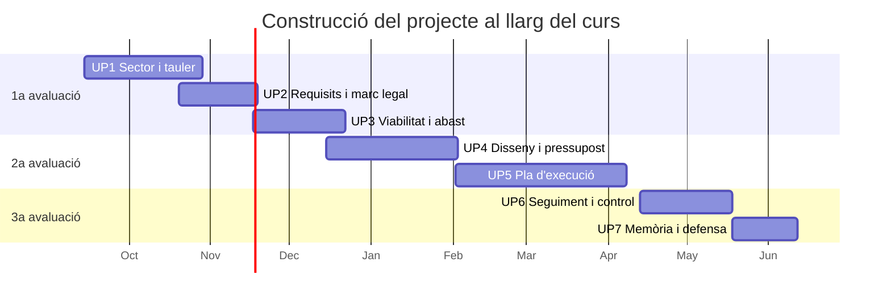

# Calendari del curs

!!! warning "Dates orientatives"
    Les dates de lliurament definitives s'anuncien sempre a **Aules**. Esta pàgina servix
    per a fer-te una idea del ritme del curs i per a planificar-te amb temps.

---

## Visió general

| Trimestre | Mesos | Unitats | Hores aprox. |
|---|---|---|:--:|
| **1a avaluació** | setembre – desembre | UP1 · UP2 · UP3 | 13 h |
| **2a avaluació** | gener – març | UP4 · UP5 | 14 h |
| **3a avaluació** | abril – juny | UP6 · UP7 | 5 h |

Total: **32 hores**, a raó d'**una hora setmanal**.

---

## Seqüenciació per unitats

| UP | Unitat | Període | Hores | Lliurament |
|:--:|---|---|:--:|---|
| 1 | [Eines de desenvolupament de projectes](../up1/index.md) | Setembre – octubre | 3 h | Mitjan octubre |
| 2 | [Eines i metodologies de planificació](../up2/index.md) | Octubre – novembre | 4 h | Mitjan novembre |
| 3 | [Fases inicials: requisits, planificació i anàlisi](../up3/index.md) | Novembre – desembre | 6 h | Desembre, abans de Nadal |
| 4 | [Disseny d'un projecte integrador](../up4/index.md) | Desembre – gener | 5 h | Finals de gener |
| 5 | [Elaboració d'un projecte integrador](../up5/index.md) | Febrer – abril | 9 h | Principis d'abril |
| 6 | [Proves i documentació tècnica](../up6/index.md) | Abril – maig | 4 h | Mitjan maig |
| 7 | [Defensa i presentació del projecte](../up7/index.md) | Juny | 1 h | Primera quinzena de juny |

---

## Com es va construint el projecte

---

## Consells de planificació

!!! tip "Tres coses que et salvaran el curs"
    1. **No deixes cap lliurable arrere.** Cada unitat parteix de l'anterior: si no tens el
       document de requisits, no pots dissenyar res, i si no tens el disseny, no pots
       planificar l'execució.
    2. **Actualitza el quadern cada setmana**, encara que siguen tres línies. És el que
       demostra el teu seguiment (RA4) i el que et salva quan no recordes per què vas
       prendre una decisió al novembre.
    3. **Passa per tutoria abans de lliurar.** Una revisió de deu minuts estalvia una
       reentrega.

---

## Dates clau que has d'anotar

| Fita | Quan | Per què importa |
|---|---|---|
| Elecció de l'organització | Primeres setmanes | Tot el curs depén d'esta decisió |
| Contacte amb l'organització | Abans de la UP2 | Necessites algú a qui preguntar |
| Primera revisió a tutoria | Durant la UP3 | Punt de control de mig curs |
| Tancament de la 2a avaluació | Març | El gruix tècnic del projecte ja ha d'estar fet |
| Entrega de la memòria final | Juny | Recopila tot el curs |
| Defensa oral | Juny | 10 minuts que valen el 25 % del curs |
