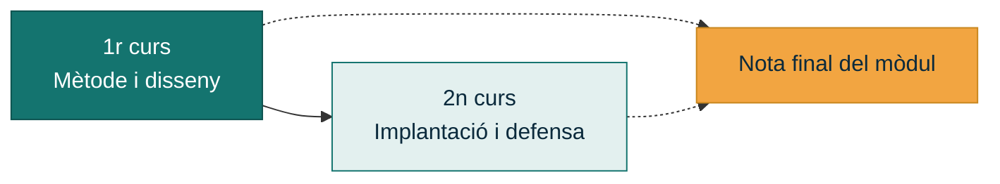
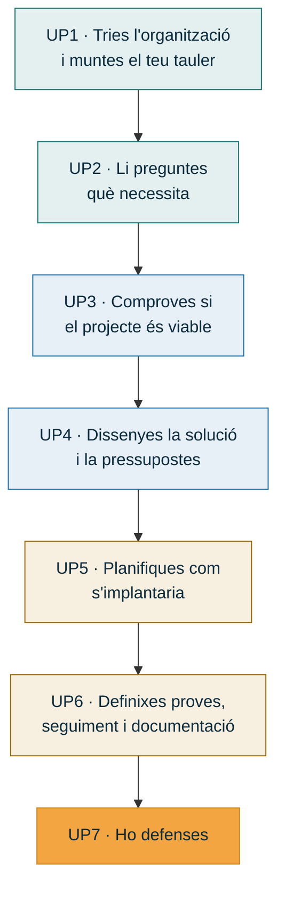

# Presentació del mòdul

## Què és el Projecte Intermodular

El Projecte Intermodular (PIM) és el mòdul on **s'ajunta tot el que aprens a la resta de
mòduls del cicle**. No és una assignatura més amb continguts propis: és el lloc on poses en
joc els coneixements d'implantació de sistemes operatius, de xarxes, de maquinari, de bases
de dades i de llenguatges de marques per a resoldre una necessitat real.

La Llei Orgànica 3/2022 d'ordenació i integració de la Formació Professional convertix el
projecte en una peça **integradora i obligatòria** de tots els cicles. Es desenvolupa al
llarg dels **dos cursos**: en primer aprens el mètode i construïxes el projecte sobre el
paper; en segon el portes a la pràctica i el defenses.

!!! note "La nota final del mòdul"
    `Nota PIM = nota de 1r × 0,25 + nota de 2n × 0,75`

    El que fas este curs val una quarta part de la nota final del mòdul, però sobretot
    és el que et deixarà preparat per a afrontar el projecte de segon amb garanties.

---

## Per a què servix en un cicle d'ASIX

La competència general del títol és **configurar, administrar i mantindre sistemes
informàtics**, garantint la funcionalitat i la integritat dels recursos i serveis, amb la
qualitat exigida i complint la reglamentació vigent.

A la vida professional, un administrador o administradora de sistemes no es limita a
instal·lar servidors: ha de saber **entendre què necessita l'organització**, **dissenyar una
solució**, **pressupostar-la**, **planificar-ne la implantació** i **documentar-la** perquè
una altra persona la puga mantindre. Eixes quatre coses són, exactament, els quatre
resultats d'aprenentatge d'este mòdul.

| Al mòdul aprens a… | A l'empresa es diu… |
|---|---|
| Identificar necessitats del sector | Anàlisi de situació, presa de requisits |
| Dissenyar el projecte i pressupostar-lo | Proposta tècnica i econòmica |
| Planificar-ne l'execució | Pla d'implantació, diagrama de Gantt |
| Definir el seguiment i el control | SLA, indicadors, gestió d'incidències i canvis |

---

## Què farem durant el curs

Cada alumne i alumna **tria una organització** (una pyme, una associació, un comerç, el
club esportiu del poble, un despatx professional…) i li dissenya la infraestructura
informàtica que necessita. Eixa organització és el teu **repte** i t'acompanya durant les
set unitats:

El projecte **creix**: cada lliurable parteix de l'anterior. Per això és important no
deixar-ne cap arrere i triar bé l'organització des del primer dia.

[:octicons-arrow-right-24: Com triar el teu repte](../projecte/index.md){ .md-button .md-button--primary }

---

## El que este mòdul **no** és

!!! warning "Tres confusions habituals"
    - **No és un mòdul de programació.** No es desenvolupa cap aplicació. El producte del
      projecte és una **infraestructura**: equips, xarxa, servidors, serveis, còpies de
      seguretat i seguretat.
    - **No és un treball de recerca.** No es tracta de descriure tecnologies, sinó de
      prendre **decisions justificades** per a un cas concret i saber defensar-les.
    - **No és un mòdul d'examen.** S'avalua amb els **lliurables** de cada unitat i amb la
      seua defensa, no amb proves escrites de teoria.

---

## Dades del mòdul

| | |
|---|---|
| **Denominació** | Projecte Intermodular |
| **Cicle** | CFGS Administració de Sistemes Informàtics en Xarxa |
| **Família professional** | Informàtica i Comunicacions |
| **Curs** | 1r (el mòdul es desenvolupa en 1r i 2n) |
| **Hores** | 32 h anuals · 1 h setmanal |
| **Modalitat de treball** | Individual, amb tutorització col·lectiva i individual |
| **Plataforma** | Aules (GVA) |

!!! info "Normativa de referència"
    - Reial Decret 1629/2009, pel qual s'establix el títol de Tècnic Superior en
      Administració de Sistemes Informàtics en Xarxa.
    - Llei Orgànica 3/2022, d'ordenació i integració de la Formació Professional.
    - Reial Decret 500/2024, que convertix el mòdul de *Projecte* en *Projecte Intermodular*.
    - Instruccions d'inici de curs de la Conselleria d'Educació.
