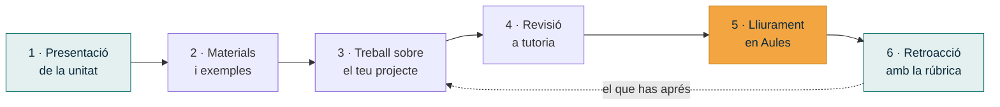

# Metodologia

## Com treballarem

El mòdul té **una hora setmanal**. És poc temps de classe, així que l'aprofitarem per a
allò que no pots fer a soles: resoldre dubtes, revisar el teu projecte i veure exemples.
La resta és treball teu, guiat pels materials d'este lloc.

La metodologia és **aprenentatge basat en reptes**: no hi ha temari que estudiar per a un
examen, hi ha un problema real que resoldre. Cada unitat aporta una peça del projecte.

| A classe | Fora de classe |
|---|---|
| Presentació de la unitat i dels conceptes clau | Lectura dels materials d'este lloc |
| Exemples resolts i casos reals | Treball sobre el teu projecte |
| Tutoria col·lectiva: dubtes comuns | Actualització del quadern de seguiment |
| Tutoria individual: revisió del teu avanç | Preparació del lliurable |
| Exposicions curtes i revisió entre iguals | |

---

## El cicle de cada unitat

La **revisió a tutoria** (pas 4) és voluntària però molt recomanable: és l'oportunitat de
saber si vas ben encaminat **abans** de lliurar, no després.

---

## Treball individual

Cada alumne i alumna porta **el seu propi projecte**, sobre una organització que tria en
la primera unitat. Això vol dir que:

- La teua feina és **teua**: no hi ha repartiment de tasques ni notes de grup.
- No hi haurà dos projectes iguals a classe, perquè no hi haurà dues organitzacions iguals.
- Sí que treballarem **en comú**: revisions entre companys, posades en comú i exposicions
  curtes formen part de les sessions.

!!! note "I el treball en equip, llavors?"
    El treball en equip s'estudia i es practica: en la [UP1](../up1/index.md) veuràs els
    rols d'un equip de sistemes i muntaràs un tauler Kanban, i en la
    [UP5](../up5/index.md) hauràs d'assignar tasques a **perfils** professionals encara que
    tu els planifiques a soles. El projecte que dissenyes és un projecte que executaria un
    equip: tu fas el paper de qui el dirigix.

---

## Materials i eines

### Materials

- **Este lloc web**: continguts, enunciats i rúbriques, sempre accessibles i actualitzats.
- **Aules**: lliuraments, qualificacions, avisos i fòrums.
- **Plantilles**: documents base per a cada lliurable, a [Recursos](../recursos/plantilles.md).

### Programari

Tot el programari del mòdul és **lliure o gratuït** i multiplataforma, així que pots
treballar des de casa amb qualsevol sistema operatiu.

| Per a què | Eines |
|---|---|
| Diagrames de xarxa i esquemes | draw.io, Excalidraw |
| Simulació de xarxes | Cisco Packet Tracer, GNS3 |
| Màquines virtuals | VirtualBox, VMware Workstation Player |
| Planificació i Gantt | GanttProject, ProjectLibre |
| Tauler Kanban | Trello, Planner (Microsoft 365 del centre), un tauler propi |
| Documentació | LibreOffice, Microsoft 365 del centre, Markdown |
| Control de versions | Git i GitHub (recomanat, no obligatori) |

[:octicons-arrow-right-24: Guia d'eines i enllaços](../recursos/index.md){ .md-button }

---

## Ús de la intel·ligència artificial

Pots utilitzar eines d'IA en este mòdul. El que **no** pots fer és entregar el que ha escrit
una IA com si fora teu, perquè el que s'avalua és el teu criteri, no la teua habilitat per
a demanar coses a un xat.

!!! abstract "Regles del joc"
    1. **Declara-ho.** Cada lliurable porta un apartat final on dius per a què has usat l'IA.
    2. **Verifica-ho.** Tota dada que et done una IA s'ha de contrastar amb una font real i
       citable. Preus, normativa i models de maquinari inventats són un error greu.
    3. **Adapta-ho.** Un text genèric que serviria per a qualsevol projecte no val: ha de
       parlar de **la teua** organització i de **les teues** decisions.
    4. **Defensa-ho.** A les tutories i a la defensa final se't pot preguntar per qualsevol
       decisió del teu document. Si no la saps explicar, no compta.

Usada així, l'IA és una eina més, com el cercador o la documentació d'un fabricant.

---

## Atenció a la diversitat

Els materials estan pensats per a poder-se seguir a ritmes diferents:

- Els continguts són **públics i permanents**: els pots repassar quan vulgues.
- Cada unitat indica un **mínim exigible** i propostes d'**ampliació**.
- Les plantilles marquen l'estructura, de manera que el pes no recaiga en la redacció.
- L'organització del projecte la tries tu: pots buscar-ne una de més senzilla o més
  ambiciosa segons el teu punt de partida.

Si necessites una adaptació concreta, parla'n amb el professorat al principi del curs.
