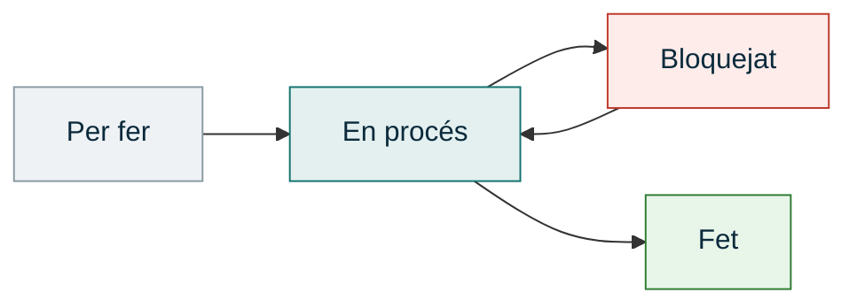

# UP1 · Eines de desenvolupament de projectes

RA1 · 40 % RA4 · 12,5 % · **3 hores** · **Pes al curs: 10 %** · *Setembre – octubre*

!!! abstract "En acabar esta unitat"
    - Sabràs com és el sector TIC de la Comunitat Valenciana i quins tipus d'empreses hi ha.
    - Hauràs triat **la teua organització** per a tot el curs.
    - Tindràs muntat el teu sistema de treball: tauler Kanban i quadern de seguiment.
    - Coneixeràs els rols d'un equip de sistemes i sabràs qui fa què en un projecte real.

---

## 1. Què és un projecte i per què fracassen

Un **projecte** és un esforç temporal amb un principi i un final, que produïx un resultat
únic. No és el mateix que una **operació**: mantindre els servidors del centre és una
operació (no s'acaba mai); migrar-los a un servidor nou és un projecte.

| | Projecte | Operació |
|---|---|---|
| Durada | Temporal, amb data de fi | Contínua |
| Resultat | Únic | Repetitiu |
| Exemple | Desplegar una VPN per a teletreball | Donar d'alta usuaris cada setmana |

### Per què fracassen els projectes informàtics

Els estudis del sector repetixen sempre les mateixes causes, i quasi cap és tècnica:

- **Requisits mal definits o canviants**: ningú va preguntar bé què necessitava el client.
- **Planificació irreal**: terminis impossibles acceptats per a guanyar el contracte.
- **Falta de comunicació** entre qui decidix, qui paga i qui executa.
- **Abast que creix sense control** (*scope creep*): "ja que hi som, afegix això altre".
- **No es documenta**: quan la persona que ho va muntar se'n va, ningú sap com funciona.

!!! quote "La lliçó del mòdul"
    La part difícil d'un projecte d'infraestructura no és configurar el servidor.
    És saber **quin** servidor cal, **per què**, **quant costa** i **quan** estarà llest.

---

## 2. El sector TIC: com es classifiquen les empreses

No totes les empreses d'informàtica fan el mateix. Saber en quina categoria està cadascuna
et diu quin tipus de feina s'hi fa i quin perfil professional hi encaixa.

-   :material-headset: **Consultores i serveis gestionats (MSP)**

    ---

    Administren i mantenen els sistemes d'altres empreses. És on acaba treballant bona part
    del professorat d'ASIX i de l'alumnat titulat.

-   :material-tools: **Integradores i distribuïdores**

    ---

    Munten la infraestructura: xarxa, servidors, emmagatzematge, seguretat. Venen i
    implanten solucions de tercers.

-   :material-factory: **Fabricants i empreses de producte**

    ---

    Desenvolupen maquinari, programari o serveis propis. Cisco, Fortinet, Synology, però
    també empreses valencianes de programari.

-   :material-cloud: **Operadors, hosting i núvol**

    ---

    Connectivitat, allotjament i infraestructura com a servei. Des de grans operadors fins a
    datacenters locals.

-   :material-office-building: **Departaments TIC interns**

    ---

    Empreses d'altres sectors (logística, sanitat, indústria, banca) amb sistemes propis.
    Sovint la millor porta d'entrada laboral.

### Estructura d'una empresa i on encaixa la informàtica

En una organització mitjana, els departaments típics són: direcció, administració i
finances, comercial, producció o operacions, recursos humans i **sistemes**. En una pyme
menuda, sistemes sol ser **una persona** o un servei externalitzat.

Això és clau per al teu projecte: **qui hi ha a l'altra banda** determina el disseny.
Una solució que exigix manteniment diari no serveix per a una empresa que no té informàtic.

---

## 3. Necessitats i oportunitats del sector

Estes són les necessitats que més es repetixen hui a les pymes valencianes. Te les trobaràs
a la teua organització:

| Necessitat | Què sol passar realment |
|---|---|
| **Còpies de seguretat** | Es fan a mà, en un disc extern que es queda al costat del servidor |
| **Continuïtat del servei** | Un únic equip crític sense redundància ni SAI |
| **Seguretat** | Contrasenyes compartides, sense doble factor, router de l'operador sense configurar |
| **Teletreball** | Accés remot improvisat o inexistent |
| **Protecció de dades** | Fitxers amb dades personals accessibles per a tothom |
| **Obsolescència** | Equips i sistemes operatius fora de suport |
| **Xarxa** | Wifi domèstica per a ús professional, sense separació de convidats |

Cada necessitat és una **oportunitat de negoci** per al sector: serveis gestionats, còpies
al núvol, ciberseguretat, migracions i manteniment són els serveis que més creixen.

---

## 4. Rols en un projecte de sistemes

Encara que este curs treballes a soles, el projecte que dissenyes l'executaria un equip.
Has de saber **quins perfils** hi intervenen per a poder assignar-los tasques a la
[UP5](../up5/index.md).

| Rol | De què s'encarrega |
|---|---|
| **Cap de projecte** | Planifica, controla terminis i pressupost, parla amb el client |
| **Administrador de sistemes** | Servidors, serveis, usuaris, còpies de seguretat |
| **Tècnic de xarxes** | Cablejat, electrònica de xarxa, adreçament, VLAN, wifi |
| **Tècnic de seguretat** | Tallafocs, VPN, polítiques, auditoria |
| **Tècnic de suport (helpdesk)** | Atenció a l'usuari, incidències, formació |
| **Client o usuari final** | Defineix necessitats, valida i accepta el resultat |

!!! note "Els rols d'equip de Belbin"
    Més enllà del rol tècnic, cada persona aporta una manera de treballar: qui coordina, qui
    aporta idees, qui remata els detalls, qui detecta els errors. Conéixer el teu rol
    natural t'ajuda a saber en què destaques i en què hauràs de recolzar-te en els altres.
    Ho veurem a classe amb un qüestionari breu.

---

## 5. Metodologies: predictiva o àgil

=== "Predictiva (cascada)"

    Es planifica tot al principi i s'executa per fases. Cada fase comença quan acaba
    l'anterior.

    **Va bé quan**: els requisits són estables i coneguts. Una migració de servidors, un
    desplegament de cablejat.

    **Va malament quan**: el client no sap encara què vol.

=== "Àgil (Scrum, Kanban)"

    Es treballa en cicles curts, entregant valor a cada iteració i revisant amb el client.

    **Va bé quan**: hi ha incertesa i cal adaptar-se.

    **Va malament quan**: cal un pressupost tancat i una data fixa des del principi.

=== "Al nostre mòdul"

    Una **combinació**: el projecte es planifica com a predictiu (perquè el client necessita
    saber què costa i quan estarà), però **el teu treball** el gestionaràs amb un tauler
    **Kanban**, que és el que millor s'adapta a una hora setmanal.

### El tauler Kanban

Un tauler amb columnes que representen l'estat de la feina. La regla d'or: **limita el
treball en curs**. Més de dues o tres targetes alhora en *En procés* i no acabes cap.

Cada targeta ha de tindre: **títol**, **descripció d'una línia**, **data objectiu** i, si
està bloquejada, **què la bloqueja**.

---

## 6. Eines de treball del mòdul

| Eina | Per a què | On |
|---|---|---|
| **Aules** | Lliuraments, notes, fòrums, avisos | Plataforma de la GVA |
| **Correu corporatiu** | Comunicació oficial amb el professorat | `@alu.edu.gva.es` |
| **Microsoft 365** | Documents, núvol, Planner per al Kanban | Inclòs amb la identitat digital |
| **Trello** | Alternativa de tauler Kanban | Gratuït |
| **draw.io** | Esquemes i diagrames | Gratuït, sense registre |

---

## Activitat avaluable A1 · Radiografia del sector i tauler de treball

!!! quote "Enunciat"
    Situa el teu projecte dins del sector TIC valencià, tria l'organització amb què
    treballaràs tot el curs i munta el teu sistema de treball.

**Extensió**: 8–12 pàgines · **Lliurament**: PDF a Aules · **Format**: [normes generals](../projecte/lliurables.md)

### Part 1 · El sector TIC (40 %)

1. **Sis empreses TIC**: quatre de la Comunitat Valenciana i dues d'àmbit estatal. De cadascuna:
    - Activitat principal, sectors on opera, ubicació i web.
    - Grandària aproximada (nombre de persones).
    - **Classificació** segons els cinc tipus de l'apartat 2.
    - Almenys **dues** de les valencianes han de ser pymes o startups, no grans conegudes.

2. **Una empresa tipus**: tria'n una de les sis i dibuixa'n l'**organigrama**, indicant les
   funcions de cada departament i **on encaixa la informàtica**.

3. **Necessitats i oportunitats**: a partir del que has vist, quines tres necessitats TIC
   creus que són més demandades hui a les empreses del teu entorn? Quina oportunitat de
   negoci se'n deriva per a una empresa de serveis informàtics? Justifica-ho amb el que
   has trobat, no amb generalitats.

!!! tip "On buscar"
    Distrito Digital, parcs tecnològics (Paterna, Espaitec, Ciutat Politècnica),
    la Cambra de Comerç, associacions sectorials, LinkedIn i les webs corporatives.

### Part 2 · La teua organització (35 %)

Fitxa completa de l'organització que has triat i registrat al fòrum:

- Nom, activitat, ubicació i any de constitució.
- Nombre de persones i **llocs de treball informatitzats**.
- **Organigrama** o estructura, encara que siga senzilla.
- **Situació informàtica actual**: quants equips, quin sistema operatiu, quina connexió,
  com comparteixen fitxers, si fan còpies de seguretat, qui els porta la informàtica.
- **Tres problemes o mancances** que hi hages detectat, amb una línia explicant per què
  són un problema.
- **Com has obtingut la informació**: visita, entrevista, web, coneixement previ.

### Part 3 · El teu sistema de treball (25 %)

1. **Tauler Kanban** creat i en marxa (Trello, Planner o equivalent), amb:
    - Les quatre columnes: Per fer · En procés · Bloquejat · Fet.
    - Almenys **8 targetes** amb les tasques que preveus fins a desembre.
    - Cada targeta amb descripció i data objectiu.
    - **Captura de pantalla** al document.

2. **Quadern de seguiment** iniciat, amb almenys **dues entrades** de bitàcola i **una
   decisió** registrada (per exemple, per què has triat eixa organització).
   Vegeu [com funciona el quadern](../projecte/quadern.md).

---

## Rúbrica A1

| Criteri | CE | Excel·lent (4) | Notable (3) | Suficient (2) | Insuficient (1) | Pes |
|---|:--:|---|---|---|---|:--:|
| **Identificació i classificació d'empreses** | RA1 a | Les 6 empreses amb totes les dades contrastades i ben classificades pels cinc tipus, amb justificació de la classificació | Les 6 empreses amb les dades i una classificació correcta poc justificada | Falten empreses o dades; la classificació és superficial | Menys de la meitat, o informació copiada sense comprendre | 20 |
| **Caracterització de l'empresa tipus** | RA1 b | Organigrama complet amb funcions de cada departament i ubicació justificada de la informàtica | Organigrama correcte amb funcions breus | Organigrama incomplet o sense funcions | No hi ha organigrama | 15 |
| **Necessitats i oportunitats** | RA1 c, d | Tres necessitats fonamentades en el que ha trobat, amb oportunitat de negoci argumentada | Necessitats i oportunitat correctes, amb argumentació breu | Necessitats genèriques sense relació amb les empreses analitzades | No apareix o és còpia literal | 15 |
| **Fitxa de l'organització pròpia** | RA1 a, b | Fitxa completa amb situació informàtica detallada, tres problemes ben identificats i font d'informació clara | Fitxa completa amb problemes correctes | Falten dades rellevants o els problemes són vagues | Organització no vàlida o fitxa molt incompleta | 25 |
| **Tauler Kanban** | RA4 a | Tauler operatiu amb 8+ targetes ben descrites, dates i límit de treball en curs respectat | Tauler complet amb targetes i dates | Tauler creat però amb targetes buides o sense dates | No hi ha tauler o no es demostra | 15 |
| **Quadern de seguiment** | RA4 a, c | Bitàcola iniciada amb entrades datades i decisió justificada amb alternatives | Quadern iniciat amb entrades i una decisió | Quadern testimonial o sense dates | No hi ha quadern | 5 |
| **Format, fonts i ús de la IA** | — | Compleix totes les normes de format, cita totes les fonts i declara i verifica l'ús d'IA | Compleix el format amb algun descuit menor | Incompleix normes de format o les fonts són incompletes | Sense fonts o amb informació no verificable | 5 |

`Nota = Σ (pes × nivell) ÷ 40`

---

## Per a saber-ne més

- **Distrito Digital Comunitat Valenciana** — ecosistema d'empreses tecnològiques valencianes.
- **Informe del sector TIC de la Comunitat Valenciana** — publicat anualment per patronals del sector.
- **Guia d'introducció a Kanban** — Atlassian i Trello tenen guies breus i clares.
- **Rols d'equip de Belbin** — qüestionari i descripció dels nou rols.
