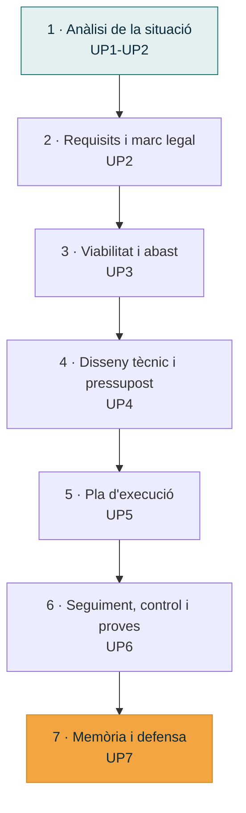

# UP2 · Eines i metodologies de planificació

RA1 · 40 % RA4 · 12,5 % · **4 hores** · **Pes al curs: 10 %** · *Octubre – novembre*

!!! abstract "En acabar esta unitat"
    - Sabràs obtindre informació real d'un client amb entrevistes, enquestes i observació.
    - Distingiràs requisits funcionals de no funcionals en un projecte d'infraestructura.
    - Coneixeràs les obligacions legals que afecten un projecte TIC: RGPD, PRL, llicències.
    - Sabràs on buscar ajudes i subvencions per a digitalització.
    - Tindràs el **guió de treball** de tot el teu projecte.

---

## 1. Com s'obté informació d'un client

El client **no sap què necessita en termes tècnics**. Sap què li fa mal: "es perden
fitxers", "va lent", "no puc treballar des de casa". La teua feina és traduir eixes queixes
en requisits.

### Les cinc tècniques

=== "Entrevista"

    Conversa dirigida amb qui pren decisions o amb qui patix el problema.

    **Punts forts**: profunditat, permet repreguntar.
    **Punts febles**: costosa en temps, depén de com preguntes.

    !!! tip "Com preparar-la"
        - Entre 8 i 12 preguntes, de generals a concretes.
        - **Obertes** primer ("Com treballeu amb els fitxers?"), **tancades** després
          ("Quants equips teniu?").
        - Mai preguntes que suggerisquen la resposta ("No creus que et faria falta un
          servidor?").
        - Acaba sempre amb: "Què és el que més et preocupa?" i "Hi ha alguna cosa que no
          t'he preguntat i hauria de saber?".

=== "Enquesta"

    Qüestionari a diverses persones, normalment usuaris finals.

    **Punts forts**: arriba a molta gent, dona dades quantificables.
    **Punts febles**: no permet aprofundir, la gent no la contesta.

    Útil per a saber, per exemple, quantes persones treballen des de casa o amb quina
    freqüència es queden sense accés a un fitxer.

=== "Observació"

    Anar al lloc i mirar com treballen de veritat.

    **Punts forts**: descobrix el que ningú et contaria, perquè s'hi han acostumat.
    **Punts febles**: consumix temps, i la gent canvia el comportament si se sent observada.

    !!! example "El que només veus observant"
        La contrasenya del wifi apuntada en un post-it a la recepció. El disc dur extern de
        les còpies de seguretat damunt del servidor. Tres persones compartint el mateix
        usuari de Windows.

=== "Anàlisi documental"

    Revisar el que ja existix: factures del proveïdor d'internet, inventari d'equips,
    contractes de manteniment, plànols del local, llicències de programari.

    **Punts forts**: dades objectives i verificables.
    **Punts febles**: sol estar desactualitzat o no existir.

=== "Benchmarking"

    Mirar què fan organitzacions semblants del mateix sector.

    **Punts forts**: aporta idees i referències de mercat.
    **Punts febles**: el que li va bé a un altre no té per què anar-te bé a tu.

### Quina tècnica per a què

| Vull saber… | Tècnica |
|---|---|
| Què vol aconseguir la direcció | Entrevista |
| Quants equips hi ha i de quin tipus | Anàlisi documental + observació |
| Quins problemes tenen els usuaris al dia a dia | Enquesta + observació |
| Quant costa el manteniment actual | Anàlisi documental (factures) |
| Què fan altres empreses del sector | Benchmarking |

---

## 2. Requisits: funcionals i no funcionals

Un **requisit** és una condició que la solució ha de complir. Es classifiquen en dos tipus:

| | Requisit funcional (RF) | Requisit no funcional (RNF) |
|---|---|---|
| Respon a | **Què** ha de fer el sistema | **Com** ho ha de fer |
| Exemple | Els usuaris han de poder accedir als fitxers compartits des de fora de l'oficina | L'accés remot ha d'estar xifrat i requerir doble factor |
| Exemple | S'ha de fer còpia de seguretat diària dels fitxers del departament d'administració | La restauració d'un fitxer no ha de tardar més de 30 minuts |

### Requisits típics d'un projecte d'infraestructura

!!! note "Per a ASIX, els requisits no van de pantalles"
    En un projecte de desenvolupament els requisits parlen de funcionalitats d'una
    aplicació. En **el nostre**, parlen de serveis, disponibilitat, seguretat i capacitat.

| Àmbit | Exemples de requisits |
|---|---|
| **Xarxa** | Cobertura wifi a tot el local · Separació de la xarxa de convidats · Cablejat a X llocs |
| **Servidors i serveis** | Servidor de fitxers · Directori d'usuaris · Servidor d'impressió · Servidor web intern |
| **Còpies de seguretat** | Còpia diària · Retenció de 30 dies · Còpia fora de l'edifici · Prova de restauració mensual |
| **Seguretat** | Tallafocs perimetral · Antivirus gestionat · Doble factor · Política de contrasenyes |
| **Disponibilitat** | SAI per als equips crítics · Temps màxim d'aturada acceptable |
| **Accés remot** | VPN per a teletreball · Accés per a el proveïdor de manteniment |
| **Capacitat** | X TB d'emmagatzematge · Creixement previst del 20 % anual |

### Com s'escriu un requisit

Un requisit ben escrit és **verificable**: es pot dir sí o no si es complix.

| ✗ Mal escrit | ✓ Ben escrit |
|---|---|
| El sistema ha de ser ràpid | L'obertura d'un fitxer de la carpeta compartida no ha de superar els 3 segons |
| Cal tindre seguretat | Tots els equips han de tindre xifratge de disc complet |
| Fer còpies de seguretat | Còpia diària automàtica a les 22:00 amb retenció de 30 dies i còpia setmanal fora de l'edifici |

Cada requisit du un **codi** (`RF1`, `RNF1`), una **prioritat** (imprescindible, important,
desitjable) i la **tècnica** amb què l'has detectat.

---

## 3. El marc legal d'un projecte TIC

Un projecte no es pot dissenyar ignorant la llei. Estes són les obligacions que has de
comprovar en el teu cas.

### Protecció de dades

El **RGPD** (Reglament UE 2016/679) i la **LOPDGDD** (LO 3/2018) s'apliquen a qualsevol
organització que tracte dades personals: les del seu personal, les dels seus clients o
les dels seus socis.

| Obligació | Què implica per al teu disseny |
|---|---|
| Registre d'activitats de tractament | Saber quines dades hi ha i on |
| Mesures tècniques adequades | Control d'accés, xifratge, còpies de seguretat |
| Còpies de seguretat i recuperació | Poder restaurar les dades davant d'un incident |
| Registre d'accessos | Saber qui ha accedit a què, especialment amb dades sensibles |
| Encarregat del tractament | Si externalitzen la informàtica, cal contracte específic |
| Notificació de bretxes | Procediment per a avisar l'AEPD en 72 hores |

!!! danger "Dades especialment protegides"
    Si la teua organització tracta dades de **salut**, **ideologia**, **religió**,
    **orientació sexual**, **origen ètnic** o **dades biomètriques**, les exigències
    augmenten molt. Una clínica o una associació d'atenció a persones és un cas més
    complex que una ferreteria: tin-ho en compte en triar.

### Altres normatives

| Norma | A què afecta |
|---|---|
| **LSSI-CE** (Llei 34/2002) | Si l'organització té web o botiga en línia: avís legal, cookies |
| **Llei 31/1995 de PRL** | Riscos laborals de la instal·lació: treball en alçada, electricitat, càrregues |
| **ENS** (RD 311/2022) | Obligatori si l'organització presta serveis a l'Administració pública |
| **NIS2** | Ciberseguretat en sectors essencials i importants |
| **Llicències de programari** | Cal comptabilitzar i pressupostar cada llicència. El programari lliure també té condicions |
| **Gestió de residus (RAEE)** | Retirada d'equips vells: no es poden tirar al contenidor |

### Prevenció de riscos en la instal·lació

Si el projecte inclou muntar cablejat, armaris rack o equips, cal preveure:

- Treball en alçada (escales, falsos sostres) i EPI corresponents.
- Riscos elèctrics: treballar sense tensió, quadres identificats.
- Manipulació de càrregues: un SAI o un rack pesen més del que sembla.
- Coordinació d'activitats empresarials si es treballa a les instal·lacions del client.

---

## 4. Ajudes i subvencions per a digitalització

Un bon projecte sap **d'on pot eixir el diner**. Estes són les vies habituals per a una
pyme valenciana:

| Programa | Qui el convoca | Per a què |
|---|---|---|
| **Kit Digital** | Red.es (Govern d'Espanya, fons Next Generation) | Digitalització de pymes i autònoms: ciberseguretat, lloc de treball segur, còpies de seguretat |
| **Ajudes IVACE** | Generalitat Valenciana | Digitalització i innovació de pymes de la Comunitat Valenciana |
| **Ajudes de la Cambra de Comerç** | Cambres de Comerç | Programes de transformació digital, sovint cofinançats per FEDER |
| **Deduccions fiscals** | Agència Tributària | Amortització accelerada d'inversió en equipament |
| **Finançament ENISA / IVF** | Estatal / autonòmic | Préstecs participatius per a inversió |

!!! warning "Comprova sempre la convocatòria vigent"
    Els imports, els terminis i les condicions canvien cada any i moltes convocatòries
    s'esgoten. Cita la convocatòria concreta amb la seua data: una referència genèrica a
    "Kit Digital" no val com a font.

---

## 5. El guió de treball del projecte

El **guió de treball** és l'índex del teu projecte: la llista ordenada del que faràs i quan.
No és el diagrama de Gantt (això arriba a la [UP5](../up5/index.md)); és el mapa del
document i de les fases.

El teu guió ha d'incloure, per a cada fase: **què conté**, **què cal tindre abans de
començar-la** i **què en resulta**.

---

## Activitat avaluable A2 · Presa de requisits i marc legal

!!! quote "Enunciat"
    Obtín informació real de la teua organització, converteix-la en un catàleg de requisits
    i determina què has de complir legalment i quines ajudes podries aprofitar.

**Extensió**: 10–15 pàgines · **Lliurament**: PDF a Aules

### Part 1 · Obtenció d'informació (25 %)

Aplica **almenys tres tècniques** de les cinc estudiades. Per a cadascuna:

1. **Entrevista** (obligatòria): guió de 8–12 preguntes i **respostes reals** de la persona
   entrevistada. Indica qui és, el seu càrrec i la data.
2. Dues tècniques més a triar: enquesta amb resultats, fitxa d'observació amb el que has
   vist, anàlisi documental amb el document consultat, o benchmarking de dues organitzacions
   semblants.

!!! info "Si no pots accedir a l'organització"
    Si t'és impossible entrevistar ningú, avisa el professorat **abans** del lliurament.
    Es pot substituir per una entrevista simulada documentada, però el nivell màxim d'este
    criteri baixa a Notable.

### Part 2 · Catàleg de requisits (35 %)

Una taula amb **entre 10 i 15 requisits**, dels quals almenys 4 han de ser no funcionals:

| Codi | Requisit | Tipus | Prioritat | Tècnica d'obtenció |
|:--:|---|:--:|:--:|---|
| RF1 | … | Funcional | Imprescindible | Entrevista |
| RNF1 | … | No funcional | Important | Observació |

Cada requisit ha de ser **verificable** i cobrir almenys quatre àmbits dels set de la
taula de l'apartat 2.

### Part 3 · Tipus de projecte i característiques (10 %)

A partir dels requisits:

- **Quin tipus de projecte** necessita esta organització? (renovació d'infraestructura,
  migració al núvol, securització, desplegament de teletreball, implantació de còpies…)
- **Tres característiques específiques** que ha de complir esta solució i que no
  compliria una solució genèrica. Per exemple: "ha de poder-se administrar sense un
  informàtic present", "ha de funcionar amb la connexió ADSL existent".

### Part 4 · Marc legal (20 %)

1. **Taula d'obligacions legals** que afecten el projecte, amb tres columnes:
   *norma · què obliga · què implica en el meu disseny*. Mínim cinc entrades.
2. **Dades personals**: quines dades personals tracta l'organització, de qui, i si n'hi ha
   d'especialment protegides.
3. **Riscos laborals**: tres riscos de la fase d'instal·lació i la mesura preventiva
   corresponent.
4. **Ajudes i subvencions**: dues convocatòries concretes i vigents que podria sol·licitar,
   amb import orientatiu, termini i font citada.

### Part 5 · Guió de treball (10 %)

L'índex complet del teu projecte per fases, indicant per a cada fase: contingut, requisit
previ i resultat. Pot ser una taula o un esquema.

---

## Rúbrica A2

| Criteri | CE | Excel·lent (4) | Notable (3) | Suficient (2) | Insuficient (1) | Pes |
|---|:--:|---|---|---|---|:--:|
| **Obtenció d'informació** | RA1 c | Tres tècniques ben aplicades amb evidències reals; l'entrevista aporta informació que no s'obtindria d'una altra manera | Tres tècniques aplicades amb evidències correctes | Tècniques aplicades superficialment o amb evidències febles | Menys de tres tècniques o sense evidències | 20 |
| **Catàleg de requisits** | RA1 c, f | 10–15 requisits verificables, ben classificats, prioritzats i traçats a la tècnica d'origen, cobrint els àmbits clau | Requisits correctes i classificats, amb alguna formulació poc verificable | Requisits vagues, mal classificats o concentrats en un sol àmbit | Menys de 10 requisits o no verificables | 30 |
| **Tipus de projecte i característiques** | RA1 e, f | Tipus de projecte ben identificat i característiques pròpies del cas, no genèriques | Tipus correcte amb característiques adequades | Identificació genèrica que serviria per a qualsevol organització | No apareix o és incoherent amb els requisits | 10 |
| **Marc legal i PRL** | RA1 g | Cinc o més obligacions ben relacionades amb decisions concretes del disseny; dades personals ben analitzades; riscos laborals pertinents | Obligacions correctes amb implicacions breus | Llistat de normes sense relacionar amb el projecte | No apareix o és incorrecte | 20 |
| **Ajudes i subvencions** | RA1 h | Dues convocatòries vigents i aplicables, amb import, termini i font citada | Dues convocatòries correctes amb dades parcials | Una convocatòria o referències genèriques sense dades | No apareix o són ajudes inexistents | 10 |
| **Guió de treball** | RA1 i | Guió complet per fases amb requisits previs i resultats, coherent amb el projecte | Guió complet amb algun apartat poc detallat | Guió superficial o còpia de l'índex del mòdul | No hi ha guió | 5 |
| **Quadern de seguiment** | RA4 a, c | Al dia, amb decisions i incidències registrades i justificades | Al dia amb registres breus | Buits importants o omplit de colp | No actualitzat | 3 |
| **Format, fonts i ús de la IA** | — | Format impecable, fonts completes amb data, IA declarada i verificada | Format correcte amb descuits menors | Format o fonts incompletes | Sense fonts o informació no verificable | 2 |

`Nota = Σ (pes × nivell) ÷ 40`

---

## Per a saber-ne més

- **Agència Espanyola de Protecció de Dades (AEPD)** — guies per a pymes i eina *Facilita RGPD*.
- **INCIBE** — guies de ciberseguretat per a pymes i pla director de seguretat.
- **Acelera Pyme / Red.es** — informació sobre Kit Digital i convocatòries vigents.
- **IVACE** — ajudes a la digitalització de pymes de la Comunitat Valenciana.
