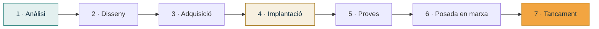

# UP3 · Fases inicials: requisits, planificació i anàlisi

RA2 · 40 % RA4 · 12,5 % · **6 hores** · **Pes al curs: 10 %** · *Novembre – desembre*

!!! abstract "En acabar esta unitat"
    - Sabràs fer un **estudi de viabilitat** des de quatre perspectives.
    - Coneixeràs les eines d'anàlisi estratègica: DAFO i CAME.
    - Sabràs fixar **objectius i abast** d'un projecte i defensar-los del creixement descontrolat.
    - Identificaràs i valoraràs els **riscos** del teu projecte.
    - Tindràs definides les **fases** del projecte amb els seus continguts.

---

## 1. Viabilitat: es pot fer?

Abans de dissenyar res, cal respondre una pregunta incòmoda: **este projecte es pot fer
de veritat?** Molts projectes fracassen perquè ningú es va atrevir a dir que no eren
viables.

La viabilitat s'analitza des de quatre perspectives:

-   :material-cog: **Tècnica**

    ---

    Existix la tecnologia? Tenim el coneixement? La infraestructura actual ho suporta?
    L'edifici té les condicions necessàries?

-   :material-currency-eur: **Econòmica**

    ---

    Quant costa? L'organització s'ho pot permetre? Quin retorn té? Hi ha alternatives
    més barates que resolguen el mateix?

-   :material-account-clock: **Organitzativa**

    ---

    Hi ha qui ho gestione després? Cal formar el personal? Es pot fer sense aturar
    l'activitat? El personal acceptarà el canvi?

-   :material-scale-balance: **Legal**

    ---

    Es complix el RGPD i la resta de normativa? Hi ha llicències necessàries? Cal algun
    permís o autorització?

### Com es redacta

Per a cada perspectiva: **què s'ha analitzat**, **quin és el resultat** i, si hi ha un
problema, **com es resol o com en condiciona el projecte**.

!!! example "Exemple de viabilitat tècnica"
    *L'edifici no té cablejat estructurat i el fals sostre no permet passar canalitzacions
    en dues zones. Es proposa cablejat estructurat a les zones accessibles i punts d'accés
    wifi gestionats a les dues zones restants. Això suposa un sobrecost de ~600 € respecte
    al cablejat complet però evita obra. **Viable amb condicions.***

Fixa't que la conclusió no és un "sí" o un "no" pelat: és una decisió tècnica justificada.

### Anàlisi cost-benefici

Encara que el pressupost detallat arriba a la [UP4](../up4/index.md), en la viabilitat
econòmica ja cal una **estimació de magnitud** i una comparació amb el cost de no fer res.

| | Situació actual | Amb el projecte |
|---|---|---|
| Cost anual de manteniment | 1 800 € | 2 400 € |
| Hores perdudes per incidències | ~40 h/any | ~8 h/any |
| Risc de pèrdua de dades | Alt (sense còpia fora) | Baix |
| Inversió inicial | — | 7 500 € |

---

## 2. DAFO i CAME

El **DAFO** és una fotografia de la situació. El **CAME** és el que fas amb eixa fotografia.
Molts treballs es queden en el DAFO, i llavors només és un quadre bonic que no servix de res.

### DAFO

|  | Origen intern | Origen extern |
|---|---|---|
| **Negatiu** | **D**ebilitats | **A**menaces |
| **Positiu** | **F**ortaleses | **O**portunitats |

!!! example "Exemple per a una gestoria de 12 persones"
    - **Fortaleses**: personal estable i acostumat a treballar amb eines digitals; local en propietat.
    - **Debilitats**: no hi ha ningú amb perfil tècnic; pressupost ajustat; equips de més de 6 anys.
    - **Oportunitats**: Kit Digital cobrix part de la inversió; el teletreball obriria la contractació.
    - **Amenaces**: increment del ransomware al sector; obligacions creixents del RGPD; possible pujada de preus del maquinari.

### CAME

Per a cada quadrant del DAFO, una estratègia:

| Del DAFO | Estratègia CAME | Què vol dir |
|---|---|---|
| **D**ebilitats | **C**orregir | Com les elimine o les reduïsc |
| **A**menaces | **A**frontar | Com em protegisc |
| **F**ortaleses | **M**antindre | Com les aprofite i les conserve |
| **O**portunitats | **E**xplotar | Com les capitalitze |

!!! example "CAME de l'exemple anterior"
    - **Corregir**: contractar un servei de manteniment gestionat mensual en lloc de dependre d'un tècnic propi.
    - **Afrontar**: còpies de seguretat amb regla 3-2-1 i còpia immutable per a resistir un ransomware.
    - **Mantindre**: aprofitar que el personal té hàbits digitals per a fer una formació breu d'una hora.
    - **Explotar**: sol·licitar el Kit Digital en la categoria de còpies de seguretat i ciberseguretat.

Cada estratègia del CAME hauria d'acabar convertint-se en **una part del teu disseny** o
en **una tasca del pla d'execució**.

---

## 3. Objectius i abast

### Objectius SMART

Un objectiu val si es pot comprovar. La regla **SMART**:

| Lletra | Significat | Pregunta |
|:--:|---|---|
| **S** | Específic | Diu exactament què s'aconseguix? |
| **M** | Mesurable | Com sabrem que s'ha aconseguit? |
| **A** | Assolible | Es pot fer amb els recursos que hi ha? |
| **R** | Rellevant | Resol una necessitat real detectada? |
| **T** | Temporal | Per a quan? |

| ✗ | ✓ |
|---|---|
| Millorar la seguretat de l'empresa | Implantar còpies de seguretat automàtiques diàries amb còpia fora de l'edifici i retenció de 30 dies, operatives abans del 31 de març |
| Modernitzar la xarxa | Substituir la wifi domèstica per tres punts d'accés gestionats amb xarxa de convidats separada, amb cobertura en tot el local |

### Abast: dins i fora

L'abast defineix **la frontera del projecte**. La part que més s'oblida és la de **fora**,
i és la que et salva de l'*scope creep*.

=== "Dins de l'abast"

    - Renovació de l'electrònica de xarxa i cablejat de les 12 posicions de treball.
    - Instal·lació d'un servidor de fitxers amb control d'accés per departaments.
    - Sistema de còpies de seguretat local i al núvol.
    - Formació bàsica d'una hora al personal.

=== "Fora de l'abast"

    - Renovació dels equips d'usuari (es reutilitzen els actuals).
    - Migració del programari de gestió comptable.
    - Desenvolupament de cap aplicació a mida.
    - Manteniment posterior a l'entrega (es contractaria a banda).

!!! danger "Scope creep"
    *"Ja que estàs, mira'm la impressora"*. Cada afegit no planificat consumix temps i
    pressupost que no estaven previstos. Un abast escrit i acceptat és l'única defensa.

---

## 4. Fases del projecte

Un projecte d'infraestructura sol tindre estes fases. A cada fase li correspon un
**resultat tangible** (un lliurable).

| Fase | Conté | Resultat |
|---|---|---|
| **1 · Anàlisi** | Situació actual, requisits, viabilitat | Document de requisits validat |
| **2 · Disseny** | Arquitectura, xarxa, serveis, pressupost | Proposta tècnica i econòmica |
| **3 · Adquisició** | Comandes, recepció, llicències | Material al lloc |
| **4 · Implantació** | Cablejat, muntatge, configuració, migració | Infraestructura operativa |
| **5 · Proves** | Verificació de requisits, proves de restauració | Acta de proves |
| **6 · Posada en marxa** | Formació, documentació, acompanyament | Sistema en producció |
| **7 · Tancament** | Acceptació del client, lliçons apreses | Acta d'acceptació |

---

## 5. Riscos

Un **risc** és un fet incert que, si passa, afecta el projecte. No es tracta d'endevinar el
futur, sinó de tindre un pla per si passa.

### Com es valora

`Exposició = Probabilitat × Impacte`, amb tots dos valorats d'1 a 5.

| Codi | Risc | Prob. | Imp. | Exp. | Resposta | Pla de contingència |
|:--:|---|:--:|:--:|:--:|---|---|
| R1 | El proveïdor retarda l'entrega del servidor | 3 | 4 | 12 | Mitigar: demanar amb 4 setmanes d'antelació | Llogar un equip temporal |
| R2 | El cablejat no es pot passar pel fals sostre | 2 | 4 | 8 | Mitigar: inspecció prèvia | Canalització vista o wifi |
| R3 | Pèrdua de dades durant la migració | 2 | 5 | 10 | Evitar: còpia completa verificada abans | Restaurar de la còpia |
| R4 | El personal no adopta el nou sistema | 3 | 3 | 9 | Mitigar: formació i acompanyament | Sessió de reforç |

### Les quatre respostes possibles

| Resposta | Quan s'aplica |
|---|---|
| **Evitar** | Canviar el pla perquè el risc desaparega |
| **Mitigar** | Reduir la probabilitat o l'impacte |
| **Transferir** | Passar-lo a un tercer: assegurança, garantia, contracte amb SLA |
| **Acceptar** | Assumir-lo perquè el cost de tractar-lo és major que el del risc |

!!! tip "Mínim per al teu projecte"
    Almenys **sis riscos**, de categories diferents: tècnics, de planificació, econòmics,
    de personal i externs. Tots amb resposta i contingència.

---

## Activitat avaluable A3 · Estudi de viabilitat i abast

!!! quote "Enunciat"
    Determina si el teu projecte és viable, analitza'n la situació estratègica i fixa'n
    els objectius, l'abast, les fases i els riscos.

**Extensió**: 12–18 pàgines · **Lliurament**: PDF a Aules

### Part 1 · Recopilació d'informació (10 %)

Amplia la informació de la UP2 amb el que necessites per a decidir: preus orientatius de
mercat, característiques tècniques del local, fitxes de producte, condicions de la connexió
actual. Indica **què has hagut de buscar** i **on ho has trobat**.

### Part 2 · Estudi de viabilitat (30 %)

Anàlisi de les **quatre** perspectives (tècnica, econòmica, organitzativa i legal). Per a
cadascuna: què has analitzat, resultat i condicionants. Inclou:

- Una **estimació de magnitud** del cost (encara no el pressupost detallat).
- Una taula de **cost de no fer res** enfront de **cost del projecte**.
- Una **conclusió global**: viable, viable amb condicions o no viable, i per què.

### Part 3 · DAFO i CAME (20 %)

- **DAFO** amb almenys **tres elements per quadrant**, cadascun justificat en una línia.
- **CAME** amb almenys **una estratègia per quadrant**, i indicant **on es materialitzarà**
  eixa estratègia dins del projecte.

### Part 4 · Objectius i abast (20 %)

- **Un objectiu general** i **tres o quatre objectius específics**, tots en format SMART.
- **Abast**: llista del que està **dins** (mínim 5 elements) i del que està **fora**
  (mínim 3 elements), amb una línia de justificació per als de fora.

### Part 5 · Fases del projecte (10 %)

Taula de les fases del teu projecte amb: nom, contingut, resultat tangible i durada
estimada en setmanes. Adapta les set fases genèriques al teu cas: en pots fusionar o
afegir, però justifica-ho.

### Part 6 · Registre de riscos (10 %)

Mínim **sis riscos** de categories diferents, amb probabilitat, impacte, exposició,
resposta i pla de contingència. Ordena'ls per exposició descendent.

---

## Rúbrica A3

| Criteri | CE | Excel·lent (4) | Notable (3) | Suficient (2) | Insuficient (1) | Pes |
|---|:--:|---|---|---|---|:--:|
| **Recopilació d'informació** | RA2 a | Informació pertinent, contrastada i citada, que sosté les decisions posteriors | Informació suficient i citada | Informació escassa o sense citar | No aporta informació nova | 8 |
| **Estudi de viabilitat** | RA2 b | Les quatre perspectives analitzades amb dades pròpies, condicionants concrets i conclusió argumentada | Les quatre perspectives correctes amb conclusió clara | Falta alguna perspectiva o l'anàlisi és genèrica | Menys de tres perspectives o sense conclusió | 25 |
| **DAFO i CAME** | RA2 a, b | DAFO específic del cas i CAME que es tradueix en decisions concretes del projecte | DAFO i CAME complets i coherents | DAFO correcte però CAME genèric o absent de conseqüències | DAFO genèric o sense CAME | 17 |
| **Objectius i abast** | RA2 d | Objectius SMART verificables i abast amb exclusions ben justificades | Objectius i abast correctes | Objectius poc mesurables o abast sense exclusions | No hi ha objectius o abast | 20 |
| **Fases del projecte** | RA2 c | Fases adaptades al cas, amb resultats tangibles i durades coherents | Fases completes amb resultats | Fases copiades del model sense adaptar | No apareixen | 10 |
| **Registre de riscos** | RA2 b · RA4 c | Sis o més riscos de categories diverses, ben valorats, amb resposta i contingència realistes | Sis riscos amb resposta i contingència | Menys de sis riscos o sense contingència | No hi ha registre de riscos | 12 |
| **Quadern de seguiment** | RA4 a, c | Al dia, amb decisions i incidències justificades | Al dia amb registres breus | Buits importants | No actualitzat | 5 |
| **Format, fonts i ús de la IA** | — | Format impecable, fonts completes, IA declarada i verificada | Format correcte amb descuits menors | Format o fonts incompletes | Sense fonts o dades no verificables | 3 |

`Nota = Σ (pes × nivell) ÷ 40`

---

## Per a saber-ne més

- **Guia PMBOK** (PMI) — capítols de gestió d'abast i de riscos.
- **INCIBE · Anàlisi de riscos** — metodologia adaptada a pymes.
- **MAGERIT** — metodologia d'anàlisi i gestió de riscos de les administracions públiques.
