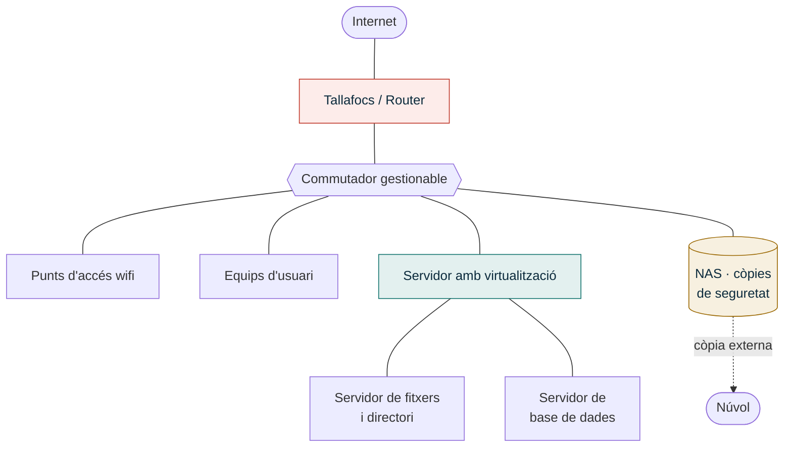
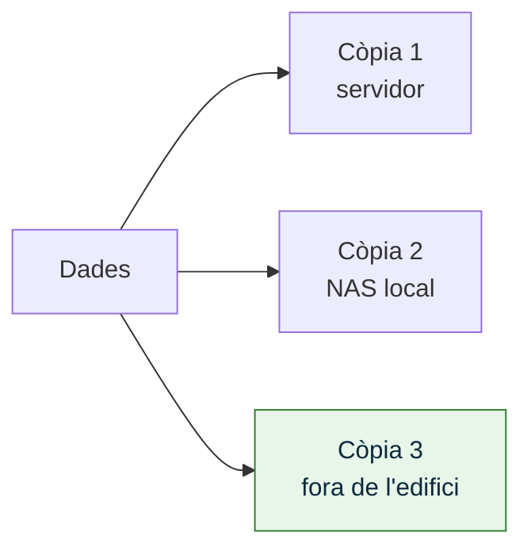

# UP4 · Disseny d'un projecte integrador

RA2 · 40 % RA4 · 12,5 % · **5 hores** · **Pes al curs: 15 %** · *Desembre – gener*

!!! abstract "En acabar esta unitat"
    - Sabràs dissenyar l'**arquitectura lògica** d'una infraestructura: clients, balanceig, servidors i base de dades.
    - Elaboraràs un **esquema de xarxa** i un **pla d'adreçament IP** amb segmentació en VLAN.
    - Triaràs i justificaràs els **serveis bàsics** i el **maquinari**.
    - Dissenyaràs un **pla de còpies de seguretat** amb criteri professional.
    - Faràs un **pressupost** complet i definiràs els **criteris de qualitat** del projecte.

Esta és la unitat més tècnica del curs i la que més pes té fins ara. Ací és on el projecte
deixa de ser paper i pren forma.

---

## 1. Arquitectura lògica

L'arquitectura lògica descriu **quines peces hi ha i com es relacionen**, sense entrar
encara en marques ni models.

### Les capes clàssiques

| Capa | Què hi ha | Decisió típica |
|---|---|---|
| **Perimetral** | Router, tallafocs, VPN | Equip de l'operador o tallafocs propi? |
| **Distribució i accés** | Commutadors, punts d'accés, cablejat | Gestionable o no gestionable? PoE? |
| **Servidors** | Servidor físic, hipervisor, màquines virtuals | Servidor propi, núvol o híbrid? |
| **Dades** | Emmagatzematge compartit, base de dades | NAS, disc intern amb RAID, SAN? |
| **Client** | Equips d'usuari, impressores, mòbils | Renovar o reutilitzar? |

!!! note "Quan cal un balancejador de càrrega"
    En una pyme de 10–30 persones, **normalment no**. Un balancejador té sentit quan hi ha
    diversos servidors donant el mateix servei i cal repartir la càrrega o garantir la
    continuïtat. Si el teu cas no ho justifica, **dir-ho i explicar per què** val més que
    posar-ne un per quedar bé. Justificar el que **no** poses també és disseny.

### Local, núvol o híbrid

| | Al local | Al núvol | Híbrid |
|---|---|---|---|
| **Inversió inicial** | Alta | Baixa | Mitjana |
| **Cost recurrent** | Baix | Alt i creixent | Mitjà |
| **Control de les dades** | Total | Depén del proveïdor | Repartit |
| **Depén de la connexió** | No | Totalment | Parcialment |
| **Manteniment** | Teu | Del proveïdor | Compartit |
| **Bo per a** | Molts fitxers, connexió fluixa | Poc personal tècnic, mobilitat | El cas més habitual |

---

## 2. Xarxa: esquema i adreçament

### Esquema físic i esquema lògic

- **Esquema físic**: on està cada equip a l'edifici, per on va el cablejat, on està el rack.
- **Esquema lògic**: com es relacionen els equips, quines VLAN hi ha, quin adreçament.

Necessites **els dos**. Fes-los amb draw.io o Packet Tracer.

### Segmentació en VLAN

Separar la xarxa en VLAN limita els problemes i millora la seguretat. Una proposta base
per a una pyme:

| VLAN | Nom | Ús | Xarxa | Notes |
|:--:|---|---|---|---|
| 10 | Gestió | Commutadors, punts d'accés, iLO | `10.0.10.0/24` | Accés restringit a administració |
| 20 | Usuaris | Equips del personal | `10.0.20.0/24` | DHCP |
| 30 | Servidors | Servidor, NAS | `10.0.30.0/24` | IP fixes |
| 40 | Convidats | Wifi de visitants | `10.0.40.0/24` | Només eixida a internet |
| 50 | Impressió i IoT | Impressores, càmeres | `10.0.50.0/24` | Sense accés a servidors |

!!! tip "La regla que has de saber defensar"
    La wifi de convidats **sempre** en una VLAN pròpia i sense accés a la resta. És la
    mesura de seguretat més barata que existix i la que més sovint falta a les pymes.

### Pla d'adreçament

Per a cada VLAN, documenta el repartiment:

| Rang | Assignació |
|---|---|
| `.1` | Porta d'enllaç |
| `.2 – .19` | Infraestructura amb IP fixa |
| `.20 – .199` | Àmbit DHCP |
| `.200 – .254` | Reserves i dispositius especials |

---

## 3. Serveis bàsics

Estos són els serveis que sol necessitar una pyme. Per a cadascun has de decidir **si el
poses**, **on** i **amb què**.

| Servei | Per a què | Opcions habituals |
|---|---|---|
| **DHCP** | Configuració automàtica dels clients | Al tallafocs, al servidor o al router |
| **DNS** | Resolució de noms interna i filtrat | Servidor propi, DNS del proveïdor, Pi-hole |
| **Directori** | Usuaris, grups, permisos, polítiques | Active Directory, Samba AD, LDAP |
| **Fitxers** | Carpetes compartides per departament | Servidor de fitxers, NAS |
| **Impressió** | Cua d'impressió centralitzada | Servidor d'impressió, impressores en xarxa |
| **Correu** | Correu corporatiu | Microsoft 365, Google Workspace, servidor propi |
| **Web intern** | Intranet, documentació | Servidor web, wiki |
| **VPN** | Teletreball i accés del proveïdor | WireGuard, OpenVPN, IPsec |
| **Antivirus gestionat** | Protecció dels llocs de treball | Solució amb consola central |
| **Monitoratge** | Saber si alguna cosa falla abans que el client | Zabbix, Nagios, Uptime Kuma |

!!! warning "No poses serveis perquè sí"
    Cada servei que afegixes és una cosa més que s'ha de mantindre, actualitzar i
    assegurar. Un servei que ningú administrarà és un forat de seguretat esperant. Justifica
    **cada** servei amb un requisit de la [UP2](../up2/index.md).

### Taula de traçabilitat

Esta taula demostra que el teu disseny respon als requisits i no a les teues ganes de posar
tecnologia:

| Requisit | Component que el satisfà | Justificació |
|---|---|---|
| RF3 · Accés als fitxers des de fora | VPN WireGuard al tallafocs | Xifrat, lleuger i sense cost de llicència |
| RNF2 · Accés remot amb doble factor | MFA al portal de la VPN | Exigit pel RGPD per a dades de clients |

---

## 4. Maquinari i dimensionament

No es tria maquinari per catàleg: es dimensiona a partir de les necessitats.

| Element | Com es dimensiona |
|---|---|
| **Servidor** | Nombre de màquines virtuals × (CPU + RAM que necessita cadascuna) + 30 % de marge |
| **Emmagatzematge** | Dades actuals + creixement anual estimat × anys de vida + espai per a instantànies |
| **SAI** | Consum dels equips crítics (W) i autonomia desitjada (minuts) |
| **Commutador** | Nombre de ports actuals + 30 % de marge · PoE si hi ha punts d'accés o telefonia |
| **Punts d'accés** | Un cada 100–150 m² i per cada 25–30 dispositius, segons construcció |
| **Connexió** | Amplada de banda de pujada si hi ha teletreball o còpies al núvol |

!!! example "Exemple de dimensionament d'emmagatzematge"
    Dades actuals: 1,2 TB · Creixement: 20 % anual · Vida prevista: 5 anys
    → `1,2 × 1,2⁵ ≈ 3 TB` de dades + espai per a instantànies i sistema
    → **4 TB útils**, que amb RAID 1 són **2 discos de 4 TB**.

---

## 5. Còpies de seguretat

L'apartat que més sovint es fa malament a les pymes, i el que més valor aporta al teu
projecte.

### La regla 3-2-1

**3** còpies de les dades, en **2** suports diferents, amb **1** fora de l'edifici.
La versió moderna afegix **1** còpia immutable o fora de línia, per a resistir el
ransomware, i **0** errors verificats.

### Què has de definir

| Paràmetre | Pregunta | Exemple |
|---|---|---|
| **Abast** | Què es copia? | Carpetes compartides, BD, configuracions, no els temporals |
| **Freqüència** | Cada quant? | Diària a les 22:00, BD cada 4 h |
| **Retenció** | Quant de temps es guarda? | 30 dies diàries, 12 mensuals |
| **RPO** | Quantes dades podem perdre? | Màxim 24 h de treball |
| **RTO** | Quant podem estar aturats? | Màxim 4 h |
| **Verificació** | Com sabem que funciona? | Restauració de prova mensual documentada |

!!! danger "Una còpia que no s'ha restaurat mai no és una còpia"
    Inclou sempre al teu disseny un **procediment de restauració de prova** amb periodicitat.
    És el que distingix un projecte professional d'un de classe.

---

## 6. Pressupost

### Estructura

| Partida | Inclou |
|---|---|
| **Maquinari** | Servidors, xarxa, NAS, SAI, cablejat, armari rack |
| **Programari i llicències** | Sistemes operatius, antivirus, còpies, ofimàtica |
| **Serveis professionals** | Hores de tècnic: instal·lació, configuració, migració |
| **Formació** | Sessions per al personal |
| **Costos recurrents** | Subscripcions anuals, manteniment, núvol |
| **Contingència** | 10–15 % de l'import total |

### Com es calculen les hores

| Perfil | Preu/hora orientatiu |
|---|---|
| Cap de projecte | 45–60 € |
| Administrador de sistemes | 35–45 € |
| Tècnic de xarxes | 35–45 € |
| Tècnic de suport | 25–35 € |

!!! tip "Distingix inversió de despesa recurrent"
    El client vol saber dos números: **què paga una vegada** (CAPEX) i **què pagarà cada
    any** (OPEX). Presenta'ls per separat i afegix una previsió del **cost total a 5 anys**.

### Finançament

Indica d'on eixiria el diner: recursos propis, préstec, rènting del maquinari o les ajudes
que vas identificar a la [UP2](../up2/index.md), amb el seu import estimat.

---

## 7. Qualitat del projecte

Què es controlarà per a saber que el projecte està ben fet:

| Aspecte | Criteri de qualitat | Com es comprova |
|---|---|---|
| Cablejat | Certificació de cada presa | Informe del certificador |
| Xarxa | Totes les VLAN operatives i aïllades | Proves de connectivitat creuades |
| Servidors | Serveis actius i accessibles | Llista de comprovació de serveis |
| Còpies | Restauració correcta d'un fitxer i d'una VM | Acta de prova de restauració |
| Seguretat | Sense contrasenyes per defecte, MFA actiu | Revisió de configuració |
| Documentació | Esquemes i credencials entregats | Acta d'entrega |
| Usuaris | Personal format i capaç d'operar | Enquesta de satisfacció |

---

## Activitat avaluable A4 · Disseny tècnic i pressupost

!!! quote "Enunciat"
    Dissenya la infraestructura completa de la teua organització i pressuposta-la.
    És el document que li presentaries per a guanyar el projecte.

**Extensió**: 15–22 pàgines · **Lliurament**: PDF a Aules, més els fitxers font dels esquemes (draw.io, Packet Tracer) en un ZIP

### Part 1 · Arquitectura lògica (15 %)

- **Diagrama de l'arquitectura** amb les seues capes.
- **Justificació de la modalitat**: local, núvol o híbrid, amb la taula comparativa
  aplicada al teu cas.
- **Decisions descartades**: almenys dues alternatives que has valorat i per què no.

### Part 2 · Xarxa (20 %)

- **Esquema físic**: distribució a l'edifici, ubicació del rack i recorregut del cablejat.
- **Esquema lògic**: equips, VLAN i interconnexions.
- **Taula de VLAN** amb el seu propòsit i la seua xarxa.
- **Pla d'adreçament IP** complet, amb el repartiment de cada rang.
- Simulació en **Packet Tracer o GNS3** de la part central (recomanat, suma en el nivell
  d'excel·lència).

### Part 3 · Serveis i maquinari (20 %)

- **Taula de serveis**: quins poses, on i amb què.
- **Taula de traçabilitat** requisit → component → justificació, cobrint tots els requisits
  imprescindibles de la [UP2](../up2/index.md).
- **Dimensionament** justificat de servidor, emmagatzematge, SAI, commutador i punts d'accés.
- **Llista de maquinari** amb model concret, característiques i font del preu.

### Part 4 · Còpies de seguretat (10 %)

Pla complet amb abast, freqüència, retenció, RPO, RTO, suports, ubicacions i procediment
de verificació. Ha de complir la regla 3-2-1 o justificar per què no.

### Part 5 · Pressupost (20 %)

- **Pressupost detallat** per partides, amb preus unitaris, quantitats i totals.
- **Separació CAPEX / OPEX** i **cost total a 5 anys**.
- **Contingència** del 10–15 % justificada.
- **Finançament**: d'on ix el diner, amb les ajudes de la UP2 quantificades.

### Part 6 · Qualitat i documentació (10 %)

- **Taula de criteris de qualitat** amb la seua forma de comprovació (mínim sis).
- **Llista de la documentació** que s'entregarà amb el projecte.

---

## Rúbrica A4

| Criteri | CE | Excel·lent (4) | Notable (3) | Suficient (2) | Insuficient (1) | Pes |
|---|:--:|---|---|---|---|:--:|
| **Arquitectura lògica** | RA2 h | Diagrama clar i coherent, modalitat justificada amb dades del cas i alternatives descartades amb argument | Diagrama correcte amb justificació breu | Diagrama genèric o justificació absent | No hi ha arquitectura o és incoherent | 13 |
| **Disseny de xarxa** | RA2 e, h | Els dos esquemes complets, VLAN ben plantejades i pla d'adreçament íntegre i sense errors; simulació funcional | Esquemes i adreçament correctes | Falta un esquema o el pla d'adreçament té errors | Sense esquemes o adreçament inviable | 18 |
| **Serveis i traçabilitat** | RA2 e, h | Tots els requisits imprescindibles traçats a un component, amb serveis justificats i cap de sobrer | Serveis adequats i traçabilitat quasi completa | Serveis llistats sense relacionar amb requisits | Serveis incoherents amb el projecte | 15 |
| **Dimensionament i maquinari** | RA2 e | Dimensionament calculat i justificat, amb models reals i preus amb font | Dimensionament correcte amb models reals | Maquinari triat sense justificar el dimensionament | Maquinari inventat o incoherent | 12 |
| **Còpies de seguretat** | RA2 i | Pla complet amb RPO, RTO i procediment de verificació documentat; complix 3-2-1 | Pla complet amb els paràmetres principals | Pla incomplet o sense còpia externa | No hi ha pla de còpies | 10 |
| **Pressupost i finançament** | RA2 f, g | Pressupost detallat i realista, CAPEX/OPEX separats, cost a 5 anys i finançament amb ajudes quantificades | Pressupost complet amb finançament identificat | Pressupost incomplet o amb preus sense font | Sense pressupost o amb xifres inventades | 17 |
| **Qualitat i documentació** | RA2 i | Sis o més criteris amb forma de comprovació concreta i llista de documentació completa | Criteris correctes amb comprovació | Criteris genèrics sense forma de comprovació | No apareixen | 8 |
| **Quadern de seguiment** | RA4 a, c, d | Al dia, amb decisions de disseny i canvis registrats i justificats | Al dia amb registres breus | Buits importants | No actualitzat | 4 |
| **Format, fonts i ús de la IA** | — | Format impecable, totes les fonts de preus i fitxes citades, IA declarada i verificada | Format correcte amb descuits menors | Fonts incompletes | Sense fonts o preus no verificables | 3 |

`Nota = Σ (pes × nivell) ÷ 40`

---

## Per a saber-ne més

- **Cisco Packet Tracer** — simulació de la xarxa dissenyada.
- **draw.io** — plantilles de diagrames de xarxa i d'arquitectura.
- **Veeam / Synology** — guies sobre la regla 3-2-1 i el disseny de còpies.
- **INCIBE · Pla director de seguretat** — criteris de seguretat aplicables a pymes.
