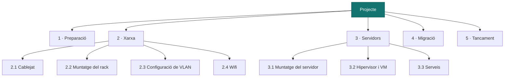
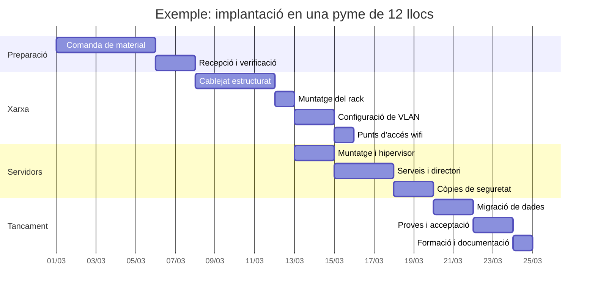

# UP5 · Elaboració d'un projecte integrador

RA3 · 40 % RA4 · 12,5 % · **9 hores** · **Pes al curs: 20 %** · *Febrer – abril*

!!! abstract "En acabar esta unitat"
    - Sabràs descompondre un projecte en tasques (EDT) i seqüenciar-les.
    - Elaboraràs un **diagrama de Gantt** amb dependències i camí crític.
    - Assignaràs **recursos humans i materials** a cada tasca i en calcularàs el cost.
    - Redactaràs **procediments d'execució** que una altra persona puga seguir.
    - Identificaràs **permisos, autoritzacions i riscos laborals** de la instal·lació.
    - Muntaràs una **maqueta** funcional d'una part del teu disseny.

És la unitat més llarga del curs i la que més pes té fins ara. Ací passes del *què* al *com*.

---

## 1. De l'abast a les tasques: l'EDT

L'**estructura de descomposició del treball** (EDT, o WBS en anglés) trosseja el projecte
fins a arribar a tasques que es poden assignar, estimar i comprovar.

### La regla del paquet de treball

Una tasca està prou desglossada quan:

- Dura **entre 4 i 40 hores**. Menys, és micro-gestió; més, no la pots controlar.
- Té **un únic responsable**.
- Té un **resultat comprovable**: es pot dir si està feta o no.
- Es pot **estimar** amb confiança.

| ✗ Massa gran | ✓ Bé |
|---|---|
| Muntar la xarxa | 2.1 Passar cablejat a les 12 posicions · 2.2 Muntar i etiquetar el rack · 2.3 Configurar VLAN al commutador · 2.4 Instal·lar i configurar 3 punts d'accés |

### Codificació

Numera les tasques jeràrquicament (`2.3`, `3.1.2`). Ho necessitaràs per a referenciar-les
al Gantt, al pressupost i al registre d'incidències.

---

## 2. Seqüenciació i dependències

No totes les tasques poden començar quan vulguen. Les relacions més habituals:

| Tipus | Significat | Exemple |
|:--:|---|---|
| **FI → IN** | L'anterior acaba i comença la següent | El cablejat acaba abans de muntar el rack |
| **IN → IN** | Comencen alhora | Configurar VLAN i configurar wifi |
| **FI → FI** | Acaben alhora | Migració de dades i verificació |
| **IN → FI** | Poc habitual | — |

### El camí crític

El **camí crític** és la seqüència de tasques més llarga del projecte: determina la data de
fi. Un retard en qualsevol tasca del camí crític retarda tot el projecte; un retard en una
tasca fora del camí crític es pot absorbir.

!!! tip "Per què t'importa"
    Quan el client et pregunte *"i si ho necessite per a dues setmanes abans?"*, la resposta
    està al camí crític: només es guanya temps escurçant eixes tasques, no les altres.

---

## 3. El diagrama de Gantt

Representa les tasques al temps. El fas amb **GanttProject** o **ProjectLibre**, tots dos
gratuïts.

### Què ha de tindre el teu Gantt

- Totes les tasques de l'EDT, amb el seu codi.
- Dates d'inici i fi, i durada en dies.
- **Dependències** dibuixades.
- **Fites** (*milestones*) en els punts clau: material rebut, xarxa operativa, sistema en producció.
- **Responsable** de cada tasca.
- **Camí crític** marcat.

---

## 4. Recursos i logística

### Recursos humans

Per a cada tasca, quin perfil la fa i quantes hores hi dedica:

| Codi | Tasca | Perfil | Hores | €/h | Cost |
|:--:|---|---|:--:|:--:|---:|
| 2.1 | Cablejat de 12 posicions | Tècnic de xarxes | 16 | 40 | 640 € |
| 3.2 | Hipervisor i màquines virtuals | Admin. de sistemes | 8 | 42 | 336 € |

!!! warning "Compte amb la sobreassignació"
    Si el teu Gantt posa el mateix tècnic a dues tasques simultànies, el pla no és viable.
    Revisa-ho: és l'error més comú.

### Recursos materials i logística

- **Material**: el de la [UP4](../up4/index.md), però ara amb **quan** ha d'estar al lloc.
- **Terminis de proveïdor**: un servidor pot tardar 3–6 setmanes. Comença l'EDT per ací.
- **Eines**: certificador de cablejat, crimpadora, escala, carro d'eines.
- **Espai**: on es guarda el material que arriba abans de muntar-se.
- **Finestres de treball**: quan es pot treballar sense parar l'activitat? Molts projectes
  s'executen en cap de setmana o de vesprada, i això encarix les hores.

---

## 5. Permisos i autoritzacions

Sovint oblidats, i sovint els que retarden un projecte:

| Tipus | Quan cal | Qui l'atorga |
|---|---|---|
| Accés a les instal·lacions fora d'horari | Treball nocturn o en cap de setmana | Direcció de l'organització |
| Obra menor o canalitzacions | Si cal fer regates o passar canalitzacions vistes | Ajuntament, propietat de l'immoble |
| Autorització del propietari del local | Si el local és de lloguer | Arrendador |
| Aturada de servei planificada | Si cal parar sistemes en producció | Direcció, amb avís al personal |
| Accés a dades personals | Si el tècnic manipularà dades | Contracte d'encarregat del tractament (RGPD) |
| Coordinació d'activitats empresarials | Treball a les instal·lacions d'un tercer | Servei de prevenció de les dues empreses |
| Retirada d'equips vells | Sempre que es desmantelle maquinari | Gestor autoritzat de RAEE |

---

## 6. Procediments d'execució

Un **procediment** és la recepta per a fer una tasca. Ha de permetre que **una altra
persona** l'execute igual que tu.

!!! example "Estructura d'una fitxa de procediment"

    **P-03 · Configuració de les VLAN al commutador**

    - **Objectiu**: deixar operatives les VLAN 10, 20, 30, 40 i 50 segons el pla de la UP4.
    - **Requisits previs**: commutador muntat, alimentat i accessible per consola.
    - **Materials i eines**: cable de consola, portàtil amb client SSH, pla de VLAN imprés.
    - **Passos**:
        1. Connectar per consola i accedir en mode privilegiat.
        2. Crear les VLAN amb el seu nom segons la taula.
        3. Assignar els ports d'accés a la seua VLAN.
        4. Configurar els enllaços troncals cap al tallafocs i els punts d'accés.
        5. Guardar la configuració en memòria persistent.
    - **Verificació**: un equip de cada VLAN obté IP del seu rang; un equip de convidats
      **no** arriba als servidors.
    - **Reversió**: restaurar la configuració desada abans de començar.
    - **Riscos**: pèrdua de connectivitat durant el canvi. Executar fora d'horari.

Cal que redactes **almenys quatre procediments** de tasques diferents.

---

## 7. Prevenció de riscos laborals

Les tasques d'instal·lació tenen riscos físics reals:

| Risc | On apareix | Mesura preventiva | EPI |
|---|---|---|---|
| Caiguda d'alçada | Cablejat en fals sostre | Escala homologada, mai sobre cadires; segona persona | Calçat de seguretat |
| Contacte elèctric | Quadre elèctric, alimentació del rack | Treball sense tensió, verificació d'absència | Guants dièlectrics |
| Sobreesforç | Muntatge de SAI i servidors al rack | Entre dues persones, ajudes mecàniques | Calçat de seguretat |
| Talls | Manipulació de cables i safates | Eines adequades, no improvisar | Guants de protecció mecànica |
| Caiguda d'objectes | Muntatge al rack | Zona delimitada, ordre de muntatge de baix a dalt | Casc si escau |
| Postures forçades | Treball sota taules i en armaris | Pauses, il·luminació adequada | — |

---

## 8. Valoració econòmica de l'execució

Ara ja tens hores per tasca i perfil, així que pots afinar el pressupost de la UP4:

| Concepte | Import |
|---|---|
| Mà d'obra (suma de les tasques) | 3 240 € |
| Recàrrec per treball fora d'horari (20 % de 8 tasques) | 310 € |
| Desplaçaments (6 visites) | 180 € |
| Lloguer de certificador de cablejat (2 dies) | 120 € |
| **Total execució** | **3 850 €** |

Compara-ho amb l'estimació de la UP4 i **explica les desviacions**. És exactament el que
passa als projectes reals.

---

## Activitat avaluable A5 · Pla d'execució i maqueta

!!! quote "Enunciat"
    Planifica com s'implantaria el teu projecte: tasques, calendari, recursos,
    procediments, permisos i riscos. I demostra en una maqueta que una part funciona.

**Extensió**: 18–25 pàgines · **Lliurament**: PDF a Aules + fitxer del Gantt + evidències de la maqueta (ZIP)

### Part 1 · EDT i seqüenciació (15 %)

- **EDT** completa, en diagrama o en taula jeràrquica, amb tasques codificades.
- Mínim **20 tasques** al nivell més baix, totes amb resultat comprovable.
- **Taula de dependències**: per a cada tasca, de quina depén i de quin tipus.

### Part 2 · Diagrama de Gantt (15 %)

Fet amb GanttProject o ProjectLibre, amb dependències, fites, responsables i camí crític
marcat. Inclou captura al document i el fitxer font.

### Part 3 · Recursos i logística (15 %)

- **Taula de recursos humans** per tasca: perfil, hores i cost.
- **Comprovació de sobreassignació**: demostra que ningú està en dues tasques alhora.
- **Logística**: terminis de proveïdor, eines necessàries, emmagatzematge, finestres de treball.

### Part 4 · Permisos i autoritzacions (10 %)

Taula dels permisos que necessita el teu projecte, amb qui els atorga, quant es tarda a
obtindre'ls i quan s'han de sol·licitar per a no retardar el Gantt. Mínim quatre.

### Part 5 · Procediments d'execució (15 %)

**Quatre fitxes de procediment** de tasques diferents, amb l'estructura completa de
l'apartat 6. Almenys una ha de ser de configuració i una de migració o posada en marxa.

### Part 6 · Prevenció de riscos laborals (10 %)

Taula de riscos laborals de les tasques d'instal·lació, amb mesures preventives i EPI.
Mínim cinc riscos de naturalesa diferent.

### Part 7 · Valoració econòmica de l'execució (10 %)

Cost total de l'execució a partir de les hores reals per tasca, comparat amb l'estimació
de la [UP4](../up4/index.md), i **explicació de les desviacions**.

### Part 8 · Maqueta funcional (10 %)

Munta en **màquines virtuals** o en **Packet Tracer** una part del teu disseny i demostra
que funciona. Tria una d'estes opcions o proposa'n una altra:

=== "Opció A · Serveis en VM"

    Un servidor virtualitzat amb: servei de directori o usuaris i grups, una carpeta
    compartida amb permisos per departament, i un client que hi accedix.

    **Evidències**: captures de la configuració, de l'accés correcte d'un usuari autoritzat
    i del **rebuig** d'un no autoritzat.

=== "Opció B · Xarxa simulada"

    A Packet Tracer: VLAN configurades, enrutament entre VLAN, DHCP per àmbit i llista de
    control d'accés que aïlle la VLAN de convidats.

    **Evidències**: fitxer `.pkt` i captures de `ping` que demostren la connectivitat
    esperada i l'aïllament de convidats.

=== "Opció C · Còpies de seguretat"

    Un sistema de còpia automàtica programada d'una carpeta a un altre equip o servei, amb
    **restauració verificada**.

    **Evidències**: configuració de la tasca programada, registre d'execució i captura de la
    restauració d'un fitxer esborrat a propòsit.

!!! tip "La maqueta no ha de ser tot el projecte"
    Es valora que **funcione i estiga documentada**, no la seua mida. Una VLAN ben aïllada i
    demostrada val més que quinze serveis a mitges.

---

## Rúbrica A5

| Criteri | CE | Excel·lent (4) | Notable (3) | Suficient (2) | Insuficient (1) | Pes |
|---|:--:|---|---|---|---|:--:|
| **EDT i seqüenciació** | RA3 a | 20+ tasques ben dimensionades amb resultat comprovable i dependències completes i coherents | EDT completa amb dependències correctes | Tasques massa grans o dependències incompletes | EDT absent o inservible | 14 |
| **Diagrama de Gantt** | RA3 f | Gantt complet amb dependències, fites, responsables i camí crític identificat i comentat | Gantt complet amb dependències i fites | Gantt sense dependències o sense fites | No hi ha Gantt o no correspon a l'EDT | 14 |
| **Recursos i logística** | RA3 b, f | Assignació per tasca amb cost, sense sobreassignacions, i logística amb terminis de proveïdor considerats | Recursos assignats correctament | Assignació incompleta o amb sobreassignacions no detectades | No hi ha assignació de recursos | 13 |
| **Permisos i autoritzacions** | RA3 c | Quatre o més permisos pertinents, amb responsable, termini i moment de sol·licitud integrat al Gantt | Permisos correctes amb responsable | Llistat genèric sense relació amb el cas | No apareixen | 9 |
| **Procediments d'execució** | RA3 d | Quatre procediments reproduïbles amb verificació i reversió; una altra persona els podria executar | Quatre procediments complets | Procediments vagues o sense verificació | Menys de quatre o no són procediments | 14 |
| **Prevenció de riscos laborals** | RA3 e | Cinc o més riscos reals de les tasques previstes, amb mesures i EPI concrets | Cinc riscos amb mesures | Riscos genèrics no relacionats amb les tasques | No apareixen | 9 |
| **Valoració econòmica** | RA3 g | Cost calculat a partir de les hores reals, comparat amb la UP4 i amb desviacions explicades | Cost complet amb comparació | Cost sense comparació o amb errors de càlcul | No hi ha valoració | 9 |
| **Maqueta funcional** | RA3 d | Maqueta operativa, ben documentada, amb evidències que demostren també el cas negatiu | Maqueta operativa amb evidències | Maqueta incompleta o evidències insuficients | No hi ha maqueta | 11 |
| **Quadern de seguiment** | RA4 a, c, d | Al dia, amb incidències d'execució i canvis registrats i quantificats | Al dia amb registres breus | Buits importants | No actualitzat | 4 |
| **Format, fonts i ús de la IA** | — | Format impecable, fonts completes, IA declarada i verificada | Format correcte amb descuits menors | Fonts incompletes | Sense fonts | 3 |

`Nota = Σ (pes × nivell) ÷ 40`

---

## Per a saber-ne més

- **GanttProject** i **ProjectLibre** — planificació lliure amb camí crític.
- **Guia PMBOK** — gestió del cronograma i dels recursos.
- **INSST** — fitxes de prevenció de riscos en treballs d'instal·lació i manteniment.
- **Cisco Packet Tracer** — laboratori per a la maqueta de xarxa.
