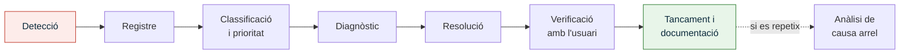

# UP6 · Proves i documentació tècnica

RA3 · 40 % RA4 · 12,5 % · **4 hores** · **Pes al curs: 10 %** · *Abril – maig*

!!! abstract "En acabar esta unitat"
    - Dissenyaràs un **pla de proves** que verifique cada requisit del projecte.
    - Definiràs **indicadors de qualitat** i com es mesuren.
    - Establiràs procediments de **gestió d'incidències** i de **control de canvis**.
    - Sabràs què és un **hardening** bàsic i el documentaràs.
    - Elaboraràs la **documentació tècnica** i el **manual d'usuari** del projecte.
    - Faràs un **post mortem**: què ha eixit bé, què no i què aprens.

---

## 1. Pla de proves

Un projecte no està acabat quan tot està instal·lat: està acabat quan s'ha **demostrat**
que complix els requisits.

### Tipus de proves

| Tipus | Què comprova | Exemple |
|---|---|---|
| **Funcional** | Que el servei fa el que ha de fer | Un usuari d'administració obri la carpeta compartida |
| **De seguretat** | Que el que no ha de passar no passa | Un equip de la VLAN de convidats **no** arriba al servidor |
| **De rendiment** | Que va prou ràpid | Obrir un fitxer de 20 MB des de la xarxa tarda menys de 3 s |
| **De recuperació** | Que es pot tornar arrere | Restaurar un fitxer esborrat de la còpia d'ahir |
| **D'acceptació** | Que el client hi està d'acord | El responsable signa l'acta de proves |

### Com es documenta una prova

Cada prova ha d'estar lligada a un **requisit** de la [UP2](../up2/index.md):

| Codi | Requisit | Prova | Resultat esperat | Resultat | Estat |
|:--:|:--:|---|---|---|:--:|
| PR-01 | RF3 | Connectar per VPN des de fora i obrir la carpeta compartida | Accés correcte en menys de 10 s | Accés en 6 s | ✅ |
| PR-02 | RNF2 | Intentar connectar per VPN sense el segon factor | Connexió rebutjada | Rebutjada | ✅ |
| PR-03 | RF7 | Esborrar un fitxer i restaurar-lo de la còpia | Fitxer recuperat íntegre | Recuperat, 4 min | ✅ |
| PR-04 | RNF1 | Equip de convidats fa ping al servidor | Sense resposta | Respon ❌ | 🔁 |

!!! tip "Les proves negatives són les que valen"
    Comprovar que una cosa funciona és fàcil. El que demostra que has fet bé la feina és
    comprovar que **el que no ha de passar, no passa**: que convidats no arriba a servidors,
    que un usuari sense permís no obri la carpeta de nòmines, que sense doble factor no
    s'entra.

---

## 2. Indicadors de qualitat

Un **indicador** convertix una sensació en un número. "La xarxa va bé" no és un indicador;
"disponibilitat del 99,5 % mensual" sí.

| Indicador | Com es mesura | Objectiu |
|---|---|---|
| Disponibilitat dels serveis | Monitoratge (Uptime Kuma, Zabbix) | ≥ 99,5 % mensual |
| Còpies correctes | Registre del programari de còpies | 100 % de còpies sense error |
| Proves de restauració | Acta mensual | 1 restauració verificada al mes |
| Temps de resolució d'incidències | Registre d'incidències | < 4 h les crítiques |
| Incidències repetides | Registre d'incidències | < 10 % del total |
| Equips amb actualitzacions al dia | Consola de gestió | ≥ 95 % |
| Satisfacció dels usuaris | Enquesta trimestral | ≥ 7/10 |

### Acords de nivell de servei (SLA)

Si el manteniment es contracta, l'SLA fixa els compromisos:

| Prioritat | Definició | Temps de resposta | Temps de resolució |
|---|---|:--:|:--:|
| **Crítica** | Servei aturat, ningú pot treballar | 1 h | 4 h |
| **Alta** | Un departament afectat | 4 h | 1 dia laborable |
| **Mitjana** | Un usuari afectat, hi ha alternativa | 1 dia | 3 dies laborables |
| **Baixa** | Consulta o millora | 2 dies | Segons planificació |

---

## 3. Gestió d'incidències

### El circuit

### Fitxa d'incidència

| Camp | Contingut |
|---|---|
| Codi i data | INC-2027-014 · 12/05/2027 10:24 |
| Qui la reporta | Usuari, monitoratge o tècnic |
| Descripció | Què passa, no què creu l'usuari que passa |
| Servei afectat i abast | Quantes persones no poden treballar |
| Prioritat | Segons la taula d'SLA |
| Diagnòstic | Què s'ha comprovat i què s'ha descartat |
| Solució aplicada | Què s'ha fet exactament |
| Causa arrel | Per què va passar |
| Mesura preventiva | Què s'ha fet perquè no torne a passar |
| Temps de resolució | Per a l'indicador |

!!! warning "Incidència i problema no són el mateix"
    La **incidència** és "hui no funciona el correu": es resol restablint el servei.
    El **problema** és "el correu falla cada dilluns": es resol trobant la causa. Si només
    resols incidències, les tindràs eternament.

---

## 4. Gestió de canvis

Un canvi no autoritzat és la primera causa de caiguda de servei. El procediment mínim:

1. **Sol·licitud**: qui el demana, què vol canviar i per què.
2. **Avaluació**: impacte en cost, terminis, risc i altres serveis.
3. **Aprovació o rebuig**: qui decidix i amb quin criteri.
4. **Planificació**: quan s'aplica i amb quina finestra de servei.
5. **Execució amb pla de reversió**: sempre ha d'haver-hi marxa arrere.
6. **Verificació i registre**: comprovar i anotar al [quadern](../projecte/quadern.md).

| Codi | Data | Canvi sol·licitat | Motiu | Impacte | Decisió |
|:--:|---|---|---|---|:--:|
| CC-01 | 03/02 | Afegir una segona seu al projecte | Obertura de nova oficina | +1 200 € · +2 setmanes | Aprovat |
| CC-02 | 18/03 | Substituir el NAS per còpia només al núvol | Reduir inversió inicial | −900 € inicial · +40 €/mes · RTO pitjor | Rebutjat |

Fixa't que **rebutjar un canvi amb arguments** val tant com aprovar-lo.

---

## 5. Hardening essencial

El **hardening** és reduir la superfície d'atac d'un sistema. El mínim que has de
documentar al teu projecte:

=== "Sistemes i serveis"

    - Canviar **totes** les contrasenyes per defecte, també les dels commutadors i punts d'accés.
    - Desactivar serveis i ports que no s'usen.
    - Actualitzacions de seguretat automàtiques o planificades.
    - Separar els comptes d'administració dels d'ús diari.
    - Registre d'esdeveniments actiu i conservat.

=== "Xarxa"

    - Xarxa de gestió separada de la d'usuaris.
    - VLAN de convidats aïllada, amb accés només a internet.
    - Regles de tallafocs restrictives per defecte: es permet el que cal, es denega la resta.
    - Desactivar l'administració remota del router des d'internet.
    - WPA3 o WPA2-Enterprise a la wifi corporativa.

=== "Usuaris i dades"

    - Permisos pel principi de **mínim privilegi**: cada persona veu només el que necessita.
    - Doble factor en els accessos remots i administratius.
    - Política de contrasenyes i gestor de contrasenyes corporatiu.
    - Xifratge de disc als portàtils.
    - Revisió periòdica de comptes: donar de baixa qui ja no hi treballa.

=== "Còpies de seguretat"

    - Còpia fora de línia o immutable, fora de l'abast d'un ransomware.
    - Credencials de les còpies diferents de les del domini.
    - Restauracions de prova documentades.

---

## 6. Documentació tècnica

La documentació és el que permet que **una altra persona** puga mantindre el sistema.
Un projecte sense documentació no es pot mantindre: es torna a fer.

| Document | Contingut |
|---|---|
| **Esquemes** | Físic i lògic, actualitzats al final |
| **Inventari** | Equips, números de sèrie, garanties, llicències |
| **Configuracions** | Còpia de les configuracions i fitxers comentats |
| **Credencials** | En gestor de contrasenyes, mai en un document pla |
| **Procediments** | Els de la [UP5](../up5/index.md), actualitzats amb el que ha canviat |
| **Pla de còpies** | Abast, calendari i procediment de restauració |
| **Pla de recuperació** | Què fer si cau el servidor o hi ha un ransomware |
| **Manual d'usuari** | Per al personal, no per a tècnics |
| **Acta d'entrega** | Què s'entrega i qui ho accepta |

### El manual d'usuari

Escrit per a qui no és informàtic: passos numerats, captures, sense argot. Tres o quatre
pàgines amb el que la gent farà de veritat:

- Com accedir a les carpetes compartides i on va cada cosa.
- Com connectar-se des de casa.
- Com canviar la contrasenya i què fer si l'oblida.
- Com imprimir.
- **A qui avisar** quan alguna cosa falla i quina informació donar.

---

## 7. Post mortem

En tancar un projecte, una reunió i un document breu:

| Pregunta | Per a què |
|---|---|
| Què ha eixit bé? | Per a repetir-ho |
| Què ha eixit malament? | Per a evitar-ho |
| Què ens ha sorprés? | Riscos que no havíem previst |
| Quant hem desviat en temps i cost? | Per a estimar millor la pròxima vegada |
| Què faríem diferent? | Lliçons apreses |

!!! quote "Regla del post mortem"
    Es parla de **processos i decisions**, no de persones. Si es converteix en una recerca
    de culpables, la pròxima vegada ningú dirà la veritat.

---

## Activitat avaluable A6 · Pla de seguiment i control

!!! quote "Enunciat"
    Definix com es comprovaria, es mesuraria i es controlaria el teu projecte, i prepara
    la documentació que s'entregaria al client.

**Extensió**: 14–20 pàgines · **Lliurament**: PDF a Aules

### Part 1 · Pla de proves (25 %)

Taula amb **mínim 12 proves**, cadascuna lligada a un requisit de la [UP2](../up2/index.md):
codi, requisit, descripció, resultat esperat i criteri d'acceptació.

- Almenys **tres proves negatives** (de seguretat o d'aïllament).
- Almenys **una prova de restauració** de còpia de seguretat.
- Almenys **una prova de rendiment** amb un valor mesurable.
- Ha d'haver-hi proves de **tots** els requisits imprescindibles.

### Part 2 · Indicadors de qualitat i SLA (15 %)

- **Sis indicadors** amb: què mesuren, com es mesuren, amb quina eina, cada quant i quin és l'objectiu.
- **Taula d'SLA** amb quatre nivells de prioritat, temps de resposta i de resolució.

### Part 3 · Gestió d'incidències (15 %)

- **Procediment** complet del circuit d'incidències.
- **Model de fitxa** d'incidència.
- **Dos exemples omplits** amb incidències versemblants del teu projecte, amb causa arrel
  i mesura preventiva.

### Part 4 · Gestió de canvis (10 %)

- **Procediment** de gestió de canvis amb els seus sis passos.
- **Registre** amb almenys **tres canvis** del teu projecte, un dels quals **rebutjat amb
  justificació**, indicant l'impacte en cost i terminis.

### Part 5 · Hardening (10 %)

**Llista de comprovació** de seguretat aplicada al teu projecte, amb mínim **12 punts**
repartits entre els quatre àmbits, i indicant per a cadascun **com es verifica**.

### Part 6 · Documentació tècnica (15 %)

- **Índex complet** de la documentació que s'entregaria, amb el contingut de cada document.
- **Manual d'usuari redactat**: 3–4 pàgines reals, no un índex. Ha de ser comprensible per
  a algú sense coneixements tècnics.
- **Model d'acta d'entrega i acceptació**.

### Part 7 · Post mortem (10 %)

Document de tancament amb les cinc preguntes, referit **al teu propi treball d'este curs**:
com has portat el projecte, què t'ha eixit bé, on t'has encallat, quant t'has desviat de la
teua previsió i què faries diferent. Recolza't al teu [quadern](../projecte/quadern.md).

---

## Rúbrica A6

| Criteri | CE | Excel·lent (4) | Notable (3) | Suficient (2) | Insuficient (1) | Pes |
|---|:--:|---|---|---|---|:--:|
| **Pla de proves** | RA3 h · RA4 a | 12+ proves traçades a requisits, amb proves negatives, de restauració i de rendiment, i criteris d'acceptació clars | Proves completes i traçades | Proves genèriques o sense traçabilitat; falten tipus | Menys de 12 proves o sense relació amb els requisits | 22 |
| **Indicadors i SLA** | RA4 b | Sis indicadors mesurables amb eina, periodicitat i objectiu; SLA coherent amb la criticitat dels serveis | Indicadors i SLA correctes | Indicadors no mesurables o SLA genèric | No apareixen | 14 |
| **Gestió d'incidències** | RA4 c | Procediment complet, fitxa ben dissenyada i exemples amb causa arrel i mesura preventiva | Procediment i exemples correctes | Procediment superficial o exemples poc versemblants | No apareix | 14 |
| **Gestió de canvis** | RA4 d | Procediment complet i registre amb canvis quantificats, incloent-hi un rebuig ben argumentat | Procediment i registre correctes | Registre sense quantificar impacte | No apareix | 9 |
| **Hardening** | RA4 g | 12+ punts dels quatre àmbits, aplicats al cas i amb forma de verificació | Llista completa i aplicada | Llista genèrica copiada, sense verificació | No apareix | 9 |
| **Documentació tècnica** | RA3 h · RA4 e | Índex complet i manual d'usuari realment utilitzable per un no informàtic; acta d'entrega correcta | Documentació completa amb manual correcte | Manual amb argot tècnic o massa breu | No hi ha manual | 14 |
| **Post mortem** | RA4 f | Autoavaluació honesta i concreta, amb desviacions quantificades i lliçons aplicables | Post mortem complet | Reflexió genèrica sense dades | No apareix | 9 |
| **Quadern de seguiment** | RA4 a, c, d | Al dia tot el curs, coherent amb el post mortem | Al dia amb registres breus | Buits importants | No actualitzat | 5 |
| **Format, fonts i ús de la IA** | — | Format impecable, fonts completes, IA declarada i verificada | Format correcte amb descuits menors | Fonts incompletes | Sense fonts | 4 |

`Nota = Σ (pes × nivell) ÷ 40`

---

## Per a saber-ne més

- **ITIL 4** — bones pràctiques de gestió d'incidències, problemes i canvis.
- **INCIBE · Guies de ciberseguretat per a pymes** — llistes de comprovació de hardening.
- **CIS Benchmarks** — guies detallades d'assegurament per sistema operatiu.
- **Uptime Kuma · Zabbix** — eines lliures de monitoratge.
